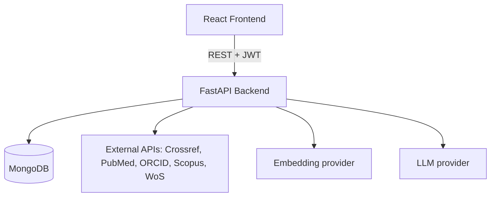

# AcadNova

**A New Era of Research.**

AcadNova is an academic research and faculty performance platform with
publication verification, performance analytics, and an AI Research Assistant.

A full-stack web application for managing research publications and
calculating annual increment eligibility based on institutional
publication/performance criteria.

> **Status: Complete.** All core modules are implemented, integrated and
> tested end-to-end: authentication & roles, faculty profiles, publications
> with external import, verification, the institutional rule engine,
> points & eligibility, document/PDF management, reports, admin management,
> and the AI/RAG Research Assistant. See [Configuration Status](#configuration-status).

## Documentation

In-depth project documentation lives in [`docs/`](docs/):

| Document | Contents |
|---|---|
| [Project Overview](docs/PROJECT_OVERVIEW.md) | Features, objectives, stack, status |
| [Architecture](docs/ARCHITECTURE.md) | System architecture & flow diagrams |
| [Database Design](docs/DATABASE_DESIGN.md) | Collections, fields, indexes |
| [API Documentation](docs/API_DOCUMENTATION.md) | All endpoint groups |
| [AI/RAG Architecture](docs/AI_RAG_ARCHITECTURE.md) | RAG pipeline, providers, safety |
| [Security](docs/SECURITY.md) | Auth, authorization, hardening |
| [Testing](docs/TESTING.md) | Test strategy and results |
| [Setup & Deployment](docs/SETUP_AND_DEPLOYMENT.md) | Installation & running |
| [User Workflows](docs/USER_WORKFLOWS.md) | Faculty & admin journeys |
| [Final Project Report](docs/FINAL_PROJECT_REPORT.md) | MCA-level report |

## Problem Statement

Research-performance tracking is typically manual and inconsistent: evidence is
scattered, duplicate publications slip through, point calculations are opaque,
verification is unauditable, and faculty cannot securely query their own
documents. This system provides a single, rule-driven, auditable platform with
strict ownership and a grounded AI assistant.

## Objectives

1. Centralise publications with external import and duplicate protection.
2. Encode the points policy as configurable rules (no hardcoded points).
3. Provide a secure, auditable verification workflow.
4. Compute points and increment eligibility from backend-owned data only.
5. Manage publication evidence PDFs securely.
6. Provide a grounded AI assistant with authoritative citations.
7. Deliver professional documentation and a fully tested system.

## Configuration Status

| Capability | Status |
|---|---|
| MongoDB, auth, faculty, publications, verification, points/eligibility, documents, reports, admin, RAG retrieval | **IMPLEMENTED** (verified end-to-end) |
| Crossref, PubMed, ORCID | **CONFIGURED** (public APIs; verified live) |
| Scopus, Web of Science | **IMPLEMENTED**; **NOT CONFIGURED** — require provider API keys |
| Semantic RAG embeddings + LLM answers | **IMPLEMENTED**; live generation requires `RAG_EMBEDDING_PROVIDER`/`RAG_LLM_PROVIDER` + `RAG_OPENAI_API_KEY` (**NOT CONFIGURED** here; endpoints return a safe configuration error — no fake answers) |


## Overview

Faculty members manage their research publications (manual entry or import from
external scholarly sources), upload PDF evidence, track research points, and
check annual increment eligibility. Administrators manage faculty, departments,
academic years, publication rules, eligibility thresholds and verification. An
AI Research Assistant answers questions grounded in a faculty member's own
processed documents, with authoritative source citations.

## System Architecture



Full diagrams (auth, publication, verification, points, PDF/RAG, QA, ER) are in
[docs/ARCHITECTURE.md](docs/ARCHITECTURE.md).

## Technology Stack

| Layer | Technology |
| ----- | ---------- |
| Frontend | React 18, Vite, React Router 6, Axios |
| Backend | Python 3.12, FastAPI, Pydantic v2, Uvicorn |
| Database | MongoDB (PyMongo) |
| Auth | JWT (PyJWT), bcrypt password hashing |
| PDF | PyMuPDF |
| Integrations | Crossref, PubMed, ORCID, Scopus, Web of Science |
| AI/RAG | Provider-independent embedding + LLM adapters (OpenAI-compatible) |

## Institutional Rule Engine

Points are **not** hardcoded — rules are stored in MongoDB
(`publication_rules`) and selected deterministically (most-specific rule wins;
equal specificity → `needs_review`; `max_claims_per_year` caps repeated claims).
The seeded catalogue (`RULE-001`…`RULE-018`) includes, for example:

- Research publication as 1st/corresponding author in Scopus/WoS/PubMed = 100 points
- Research publication as 2nd–5th co-author in Scopus/WoS/PubMed = 50 points
- ABDC/regulatory-body approved journal publication (1st/corresponding) = 30 points
- Book Editor / Book Chapter / Conference proceedings (indexed vs ISBN) = 10–50 points
- Patents (granted/published/design), copyright, start-up incubation = 10–100 points

Eligibility thresholds (also configurable in `eligibility_rules`):

- Professors & Associate Professors: minimum 200 points
- Assistant Professors: minimum 100 points
- Academic year runs 1 July to 30 June.

## Key Features

- JWT auth with faculty/admin roles; backend-authoritative ownership.
- Faculty profiles (department, designation, ORCID/Scopus/WoS/PubMed, interests).
- Publication CRUD with DOI normalisation, duplicate protection, academic-year
  derivation, search/filter/sort/pagination.
- External search/import (Crossref, PubMed, ORCID live; Scopus/WoS with keys).
- Admin verification/rejection with required reason and history.
- Configurable rule engine, points aggregation and increment eligibility.
- Secure document/PDF management (magic-byte validation, SHA-256, soft delete).
- PDF text extraction and page-aware processing.
- Reports with print and CSV export.
- Grounded AI Research Assistant with authoritative citations and safe
  no-answer/not-configured behaviour.

## Project Structure

```
research-publication-faculty-system/
├── backend/
│   ├── app/
│   │   ├── main.py
│   │   ├── config/          # Settings loaded from environment variables
│   │   ├── models/          # Enums, collection names & index definitions
│   │   ├── schemas/         # Pydantic schemas (documents + API validation)
│   │   ├── routes/          # API routes
│   │   ├── services/        # Business/service layer
│   │   ├── database/        # MongoDB connection & helpers
│   │   ├── integrations/    # External API connectors
│   │   ├── rules/           # Configurable rule engine
│   │   ├── utils/           # Helpers
│   │   └── middleware/      # Request middleware
│   ├── scripts/             # seed_rules.py, create_admin.py
│   ├── tests/
│   ├── requirements.txt
│   └── .env.example
├── frontend/
│   ├── src/
│   │   ├── components/
│   │   ├── pages/
│   │   ├── layouts/
│   │   ├── services/
│   │   ├── hooks/
│   │   ├── utils/
│   │   └── styles/
│   ├── package.json
│   └── .env.example
├── docs/                    # Project documentation (see docs/ above)
├── README.md
└── .gitignore
```

## Requirements

- Python 3.10+ (developed on 3.12)
- Node.js 18+ (frontend only)
- MongoDB (see below)

## Setting up MongoDB

You can run MongoDB locally or use MongoDB Atlas. The application uses the
database name `research_faculty_db` (configurable).

### Option A — Local MongoDB

**Ubuntu/Debian** (see the
[official install guide](https://www.mongodb.com/docs/manual/installation/)):

```bash
# Install MongoDB Community Server, then start it:
sudo systemctl start mongod
# or, if installed as a standalone binary:
mongod --dbpath /path/to/data --bind_ip 127.0.0.1 --port 27017 --fork
```

**Any platform** (portable binary, no install required):

```bash
# Download and extract the MongoDB Community tarball, then run:
mongod --dbpath /path/to/data --bind_ip 127.0.0.1 --port 27017 --fork
```

### Option B — MongoDB Atlas

1. Create a free cluster at https://www.mongodb.com/atlas.
2. Create a database user and whitelist your IP.
3. Copy the connection string and set it as `MONGODB_URI` in `.env`.

## Configuration

Copy the example environment file and adjust values as needed:

```bash
cd backend
cp .env.example .env
```

Key settings:

```
MONGODB_URI=mongodb://localhost:27017
MONGODB_DATABASE=research_faculty_db
JWT_SECRET_KEY=change-this-in-production
JWT_ALGORITHM=HS256
ACCESS_TOKEN_EXPIRE_MINUTES=60
```

## Getting Started

### Backend

```bash
cd backend
python -m venv .venv
source .venv/bin/activate        # Windows: .venv\Scripts\activate
pip install -r requirements.txt
uvicorn app.main:app --reload
```

Health check: `GET http://localhost:8000/api/health` →

```json
{"status": "ok", "database": "connected"}
```

If MongoDB is unavailable the endpoint returns:

```json
{"status": "degraded", "database": "disconnected"}
```

### Test the MongoDB connection

```bash
cd backend
pytest -v
```

### Frontend

```bash
cd frontend
npm install        # first time only
npm run dev        # dev server (http://localhost:5173)
npm run build      # production build to frontend/dist
```

The frontend calls the API at `VITE_API_BASE_URL` (default
`http://localhost:8000`) through the centralized `src/services/api.js` client,
which attaches the `Authorization` header and handles `401` redirects. The
backend allows the dev origin via `CORS_ORIGINS`.

Development URLs:

| URL | Purpose |
| --- | --- |
| `http://localhost:5173` | Frontend dev server (Vite) |
| `http://localhost:5173/api/...` | Backend API via the Vite proxy → `http://localhost:8000` |
| `http://localhost:8000/docs` | Backend Swagger UI |

#### Frontend routes

| Route | Access | Screen |
| ----- | ------ | ------ |
| `/` | public | Redirects to `/dashboard` when signed in, else `/login` |
| `/login` | public | Sign in (no sidebar/navbar) |
| `/register` | public | Faculty registration (no sidebar/navbar) |
| `/dashboard` | protected | Dashboard with real backend statistics |
| `/publications` | protected | Publication list — search, filter, sort, paginate |
| `/publications/search` | protected | Search & Import — find external publications and import them |
| `/publications/new` | protected | Add publication form |
| `/publications/:id` | protected | Publication details |
| `/publications/:id/edit` | protected | Edit publication form |
| `/documents` | protected | Documents — pick a publication, upload/manage its PDF evidence |
| `/research-assistant` | protected | AI Research Assistant — ask grounded questions about your processed documents via `POST /api/rag/query`; scope to all/publication/document; shows answers with real sources/pages |
| `/profile` | protected | My Profile — view card and edit form (name, designation, department, ORCID/Scopus/WoS/PubMed, research interests, photo) saved through `GET/PUT /api/faculty/profile`; admin accounts see a friendly "no faculty profile linked" state |
| `/reports` | protected | Research Reports — publication, points, verification and faculty summary reports |
| `/points` | protected | Points & Eligibility — summary, categories, publication breakdown, recalculate |
| `/admin` | protected, admin only | Admin Console dashboard — statistics and management shortcuts |
| `/admin/academic-years` | protected, admin only | Manage academic years — create, edit, set current, delete |
| `/admin/departments` | protected, admin only | Manage departments — create, edit, deactivate/activate, delete |
| `/admin/faculty` | protected, admin only | Faculty management — search/filter/paginate, edit profiles, activate/deactivate |
| `/admin/rules` | protected, admin only | Publication rules — create, edit, activate/deactivate with confirmations |
| `/admin/eligibility` | protected, admin only | Eligibility configurations — minimum points per designation |
| `/admin/review` | protected, admin only | Publication review queue (pending by default) |
| `/admin/review/:id` | protected, admin only | Review one publication — info, documents, verify/reject, history |
| anything else | public | Friendly 404 page |

Protected routes show a loading screen while the session is restored and
redirect to `/login` when unauthenticated; the application sidebar/navbar is
never rendered on `/login` or `/register`.

#### Authentication behaviour

- Login/register use the existing endpoints: `POST /api/auth/login`,
  `POST /api/auth/register`, `GET /api/auth/me`.
- The JWT is stored in `localStorage` under `access_token` and attached by the
  existing Axios request interceptor. Passwords are never stored.
- On application start the session is restored by calling `/api/auth/me`;
  an invalid/expired token is cleared automatically (no refresh loop).
- Any other `401` response clears the token and returns the user to `/login`;
  `403`, `404`, `5xx` and network failures map to friendly messages — stack
  traces and server internals are never displayed.
- Logout clears the token and user state and redirects to `/login`; protected
  pages are unreachable afterwards.

#### Dashboard behaviour

- Real data only — no hard-coded statistics. It reads:
  `GET /api/auth/me`, `GET /api/faculty/profile` (display name),
  `GET /api/publications` (total + verified + pending counts and the recent
  list) and `GET /api/points/summary` when an academic year can be determined
  from the faculty's own publications.
- Shows welcome + academic year, stat cards (total/verified/pending
  publications, current points, eligibility status), eligibility and
  publication-status panels, and a recent-publications table with
  text status labels (`Verified` / `Pending` / `Rejected`).
- Missing information shows `N/A` or an empty state ("No publications yet")
  instead of fabricated numbers.

#### Publications behaviour (faculty management UI)

- Routes: `/publications` (list), `/publications/new` (add),
  `/publications/:id` (details), `/publications/:id/edit` (edit).
- Real data only. The list reads `GET /api/publications` with `page`,
  `page_size`, `search`, `publication_type`, `verification_status`,
  `publication_year`, `source`, `indexing`, `sort_by` and `sort_order`;
  empty filter values are omitted from the query string, so the API never
  receives blank enum values.
- Search is debounced as you type and runs server-side across title, journal,
  conference and DOI. Filters: status (All/Pending/Verified/Rejected), type,
  year, source and indexing. Sort is whitelisted to `publication_date`,
  `created_at` and `title` with an ascending/descending toggle; page size is
  10/25/50 and pagination shows "Showing X of Y".
- Year and indexing filter options are built from the faculty's own
  publications — no fabricated option lists.
- Manual publication creation and editing share one validated form: title,
  type, date and at least one author are required, author position must be
  within the author list, and URL/DOI entries are checked. Optional fields left
  blank are cleared with `null`. Protected fields (`faculty_id`,
  `verification_status`, `points_awarded`, `source`, `source_record_id`,
  `publication_id`) are never sent, so a new publication always starts as
  `pending` with 0 points.
- The details page shows the status as text **and** symbol (✓ Verified /
  ⏳ Pending / ✕ Rejected), points only for `verified` records (otherwise `—`),
  source, indexing, the academic year derived from the publication date
  (display only), authors with the faculty's own position highlighted, the
  abstract and any links. Points are always calculated by the backend points
  engine — the UI never computes them.
- Delete requires an accessible confirmation dialog (focus trap, Esc to
  cancel) and handles `404`/`403`/`409` gracefully. All failures map to
  friendly messages; stack traces and internals are never shown.
- An external `source` never implies verification — only `verification_status`
  drives the badge. **Points are calculated by the backend points engine — the
  frontend never computes them.** Verification, document/PDF, points details
  and reports UIs follow in later steps.

#### External search & import behaviour (Step 14C)

- Route `/publications/search`, reachable from a "Search & Import" link in the
  Publications page header and from a "Publications" group in the sidebar
  (My Publications / Search & Import / Add Publication).
- Sources offered with the exact backend values: `crossref`, `pubmed`,
  `orcid`, `scopus`, `web_of_science`. Searches reuse the existing endpoints —
  Crossref/PubMed via `GET /api/publications/search-external?source=...`,
  Scopus via `GET /api/scopus/search`, Web of Science via
  `GET /api/web-of-science/search`, and ORCID via `GET /api/orcid/works`
  (works of the faculty member's linked ORCID ID; without a linked ID the
  backend returns a clear `400` message that the UI shows as-is).
- Which sources actually work depends on configuration: Crossref, PubMed and
  ORCID are public APIs and work without keys, while Scopus and Web of Science
  need API keys. Until configured, the backend answers
  `503 "<source> API key is not configured"` and the UI explains exactly which
  source is unavailable — keys are never displayed.
- The form has a source selector and a main query, plus optional advanced
  fields (title, author, DOI) for sources that accept them; the advanced block
  is hidden for ORCID, whose endpoint takes no query parameters. Page size is
  10; "Page X of Y" is computed from `total` because the API does not send a
  total-pages field. Changing the source resets the previous results.
- Empty queries and empty source selections are blocked client-side and
  re-checked by the backend (`400 query must not be empty`); unsupported source
  values are never sent.
- Each result card shows only real returned data: title, authors
  (up to three names, then "et al."), journal/conference, publisher, date or
  year, DOI, indexing, source, external record ID and an external link
  (http/https URLs only). Empty fields are omitted — nothing is labelled
  "null", and no titles, authors, journals or counts are ever fabricated.
- Import is explicit and two-step: "View" opens an accessible details dialog
  (role=dialog, focus trap, Esc, backdrop) and "Import" opens a confirmation
  dialog that restates the record before `POST /api/publications/import-external`.
  The payload contains only schema fields (`source`, `source_record_id`,
  `title`, `abstract`, `authors`, `journal`, `conference`, `publisher`, `doi`,
  `publication_date`, `publication_year`, `url`, `indexing`,
  `external_identifiers`, `author_match_confirmed`); protected fields are
  never sent.
- An import always creates the publication as `pending` with 0 points and its
  real `source`. **Points are calculated by the backend points engine after
  verification — the UI never computes them.**
- Author matching is decided by the backend, not the frontend. For
  ORCID/Scopus/Web of Science the backend can refuse an import with `400` when
  the match is not confident; the dialog then shows the backend's own factor
  text and requires an explicit "I confirm I am an author of this publication"
  checkbox before retrying with `author_match_confirmed=true`. Crossref and
  PubMed imports need no confirmation.
- Duplicates are handled, not hidden: a `409` ("This publication already
  exists in the system.") switches the dialog to a duplicate state that
  searches the faculty's own list for the same DOI (normalized) and offers
  "View Existing Publication".
- After success the dialog offers "View Publication" (`/publications/:id`) or
  a return to the search, which keeps the query and result list. Failures map
  to friendly messages (401 session, 403 permission, 404 not found, 429 rate
  limit, 502/504 unavailable, 503 not configured, safe 400 detail, network);
  stack traces, file paths and keys are never displayed.

#### Documents & PDF processing behaviour (Step 14D)

- Two entry points, one shared section: `/documents` (Documents page with a
  publication selector) and the **Documents & Evidence** section at the bottom
  of a publication's details page (`/publications/:id`). Both reuse the same
  component, so upload/process/view/download/delete behave identically.
- The Documents page loads publications with `GET /api/publications`
  (`page_size=20`, newest first) plus a debounced search field — it never
  pulls the whole publication list. Selecting a publication loads only that
  publication's documents via `GET /api/publications/{id}/documents`.
  Empty states: "No publications available. / Add a publication first." and
  "No documents uploaded for this publication."
- Upload (`DocumentUpload`) sends only `file` + `document_type` to
  `POST /api/publications/{id}/documents` — never `faculty_id`, ownership or
  storage paths. Supported types are exactly the backend enum values with
  friendly labels: Research Paper, Conference Paper, Book Chapter, Patent
  Document, Copyright Document, Supporting Evidence, Other.
- Frontend checks: PDF extension, non-empty file, and a size limit mirroring
  the backend `max_document_size_mb` setting (20 MB default) with messages
  like "Please select a PDF file.", "Invalid PDF file.", "The selected file is
  empty." and "File is too large." **The backend is the final authority**
  (magic-byte signature check, size, MIME, duplicate checksum) and its safe
  `400`/`413`/`409` messages are shown as-is. Uploads start as
  `not_processed`; nothing is processed automatically.
- Document cards show the real filename, type label, file size, upload date
  and processing status as **text + symbol** (○ Not Processed / ⏳ Processing /
  ✓ Processed / ⚠ Failed), plus page count and extracted-text length when the
  backend has them. Actions appear only when valid: Process (or "Try Again"
  after a failure), View Content and Metadata (processed only), Download and
  Delete.
- Processing is an explicit `POST .../documents/{id}/process`. The button
  disables and shows "Processing PDF…" — there is no fake progress percentage
  because the backend offers no progress stream. On success the card refreshes
  to Processed with real page count/text length; on failure the UI shows
  "PDF processing failed." plus the backend's safe `processing_error` (e.g.
  "Invalid or corrupted PDF", "Encrypted or password-protected PDF is not
  supported") and offers **Try Again**. Stack traces and paths are never
  displayed.
- The extracted-content viewer is a modal that calls
  `GET .../documents/{id}/content` and renders header facts (page count, text
  length, extraction method from the backend) with **frontend page
  navigation** — "Previous / Page X of Y / Next" — rendering only the current
  page's text so large documents stay readable on mobile
  (`white-space: pre-wrap`, no horizontal scrolling).
- The metadata modal calls `GET .../documents/{id}/metadata` and lists Title,
  Author, Subject, Keywords, Creator, Producer, Creation Date, Modification
  Date and Page Count, falling back to "Not available" for anything the PDF
  does not define. It carries the note: *"PDF metadata is extracted from the
  uploaded file and is not considered institutional verification."*
- Download uses `GET .../documents/{id}/download` as a blob and saves with the
  filename from the backend `Content-Disposition` header; the browser never
  constructs server file paths. Delete requires the shared `ConfirmDialog`
  ("Delete this document? Deleted documents cannot be accessed from the
  application."), then refreshes the list.
- Security: document responses never expose `storage_path`/`stored_filename`,
  the UI never sends ownership fields, and every operation trusts backend
  authorization — another faculty member receives `403 "You do not have
  access to this publication"` on list/upload/download/process/content/
  metadata/delete. Document activity never changes a publication's
  verification status or points (still backend-computed).
- **OCR is not implemented** (only embedded text via PyMuPDF; scanned pages
  without a text layer extract as empty). **AI/RAG, embeddings and vector
  search are not implemented.** Admin document management UI, points details
  UI and reports UI follow in later steps.

#### Publication verification & review behaviour (Step 14E)

- Two screens, real workflow only — pending → verified/rejected with the
  rejection reason captured:
  - **Faculty** — `/publications/:id` shows the verification status and, when
    rejected, the rejection reason in the "Verification & points" panel, plus
    a "Verification history" section listing every decision (action, status
    transition, date, reason, notes) from
    `GET /api/publications/{id}/verification-history` (own publications only —
    another faculty member receives `403 "You can only view the verification
    history of your own publications"`).
  - **Admin** — `/admin/review` is the review queue
    (`GET /api/admin/publications`, admin-only): debounced search
    (title/journal/conference/DOI), status filter defaulting to **pending**,
    sort (date added / publication date / title), pagination from the backend
    `total_pages`, and a Faculty column resolved from `GET /api/admin/faculty`.
    `/admin/review/:id` opens one publication: full publication information
    (status, points, owner, source, academic year, authors, details, abstract,
    links), attached documents via the shared Documents & Evidence section in
    read-only mode (download/inspect/process available; upload/delete hidden),
    and the verification history from
    `GET /api/admin/publications/{id}/verification-history`.
- Decisions: `POST /api/admin/publications/{id}/verification` with
  `{action, reason, notes}`. Verify uses the shared `ConfirmDialog` ("…the
  backend will recalculate points…"); Reject opens a dialog where the reason
  is **required** — the client blocks empty/whitespace reasons with the same
  wording the backend enforces ("Reason is required when rejecting a
  publication."). Available buttons mirror the backend transition table:
  pending → verify/reject, verified → reject, rejected → verify; a status
  with no available actions renders no buttons. Backend errors surface
  safely (`400 "Publication is already 'verified'"`, transition messages,
  `403 "Admin role required"`), with the usual session/network fallbacks.
- Points: the frontend **never awards points** — the backend points engine
  recalculates after each decision (verified publications contribute; a
  rejection leaves totals unchanged). The UI only renders
  `points_awarded`/points-API values.
- Admin queue deep-links: the admin API has no single-publication endpoint,
  so the details page locates the publication by scanning the paginated
  admin list (`findPublicationById` in `frontend/src/utils/verification.js`);
  a missing id renders "Publication not found." with a way back to the queue.
- Route protection: both admin screens render a permission state for
  non-admin sessions (the Administration sidebar section stays hidden for
  faculty), and the backend still enforces `require_admin` on every call.
- Preserved: Publications, Search & Import and the Documents/PDF UI are
  unchanged (Documents & Evidence only gained a `canManage` switch used by
  the admin view). **No OCR, no AI/RAG.**

#### Points & eligibility behaviour (Step 14F)

- `/points` is a real faculty-facing page consuming
  `GET /api/points/summary`, `POST /api/points/recalculate` and
  `GET /api/points/breakdown` with a real `academic_year_id`.
- **Backend contract fix (the only one):** the points endpoints 404 for an
  unknown year, but no faculty-readable list of academic years existed, so a
  read-only `GET /api/academic-years` (authenticated) was added. Administrative
  management stays behind `GET/POST /api/admin/academic-years` (`require_admin`,
  faculty → `403 "Admin role required"`).
- Academic-year selector: the current year is preferred with a fallback to the
  first available year; loading, empty ("No academic year is available.") and
  error + "Try Again" states. Years come from the new endpoint only.
- Summary cards render `total_points`, `eligibility.required_points` and
  `eligibility.remaining_points` straight from the API (`—` when the backend
  returns `null`), plus a status card driven by the backend `eligible`/`reason`.
- Progress panel: `total / required` with a `role="progressbar"` bar using only
  backend values; without a configured threshold it shows the backend `reason`
  ("No points data available"). Percent clamping is display-only.
- Category breakdown: all seven fixed `category_points` categories
  (`research_publication`, `book`, `conference`, `patent`, `copyright`,
  `project`, `other`) rendered as API-provided values — **the frontend never
  computes points or eligibility thresholds (no hard-coded 100/200).**
- Publication points table: each breakdown row links to the real publication
  (`/publications/:id`) and shows type, date, `rule_name || rule_code` and
  points; verified-only contributions and zero-point rows (backend `reason`,
  e.g. max claims reached / "No matching rule") are explained in place.
- "Recalculate Points" posts `{academic_year_id}` with a "Recalculating…"
  busy state, then refreshes from the response and shows "Points recalculated.";
  failures surface via `getPointsError` (401 → session expired, 403 →
  permission, 404 → "Academic year not found.", network → connect message).
- Eligibility panel: designation, required/total/remaining points, status and
  the backend `reason` (e.g. "No eligibility rule configured for this
  designation") — nothing is derived client-side beyond presentation casing.

#### Reports behaviour (Step 14G)

- `/reports` ("Research Reports") renders four report types against real
  backend data: **Publication Report**, **Annual Points Report**,
  **Verification Report** and **Faculty Research Summary**. There is no
  dedicated backend report endpoint, so each report composes existing
  authenticated APIs (no rule/points logic is duplicated in React).
- **Backend contract fix (the only one):** the Faculty Research Summary needs
  a human-readable department name, but the faculty profile only carries
  `department_id` and management is admin-only, so a read-only
  `GET /api/departments` (authenticated) was added — management stays behind
  `/api/admin/departments` (`require_admin`, faculty → `403`).
- Academic-year filter: existing `GET /api/academic-years`, current year
  preferred with first-year fallback, no hardcoded ids; switching the year
  remounts the active report (fresh fetch). Missing years show
  "No academic year is available."
- **Publication Report**: backend-paginated `GET /api/publications` scoped to
  the selected `academic_year_id` with debounced search plus status/source/
  indexing filters (all backend-supported). Columns: title (link), type,
  authors, journal/conference, DOI, source + indexing, year, status pill,
  backend `points_awarded`, and a Documents column resolved per row via
  `GET /api/publications/{id}/documents` (count only — no filesystem paths).
- **Annual Points Report**: `GET /api/points/summary` (year, faculty name,
  designation, total/required points, eligibility status) plus
  `GET /api/points/breakdown` for two tables — points per category (the seven
  `category_points` values) and points per rule (`rule_name || rule_code` with
  publication counts), each with a clear total from the backend
  `total_points`. Zero-point verified rows show the backend `reason`.
- **Verification Report**: fetches the year's publications (backend
  pagination, bounded), then each publication's
  `GET /api/publications/{id}/verification-history` with limited concurrency,
  merged newest-first: publication (link), current status, action, date/time,
  reason, notes. Internal fields (`_id`, `storage_path`, hashes,
  `verified_by_user_id`) are never rendered or exported.
- **Faculty Research Summary**: profile header (Faculty, Designation,
  Department resolved by name or "Not set", Academic Year) plus backend
  totals from `page_size=1` counts (total/verified/pending/rejected) and the
  points summary for Total Points + Eligibility Status.
- **Print**: "Print Report" uses the browser's printer (`window.print()` with
  a fresh timestamp). `@media print` hides the navbar, sidebar, filters,
  toolbars, pagination and all buttons, keeps the report title and a
  print-only meta line (report · year · faculty · generated), renders tables
  with monochrome borders and avoids colour-dependent meaning. No PDF library
  was added.
- **Export**: client-side CSV only (Blob download) for the loaded report rows,
  with RFC 4180 escaping, formula-injection guarding (`=`, `+`, `-`, `@`) and
  filenames like `publication-report-2025-2026.csv`.
- **Errors** (report-specific mapping): 401 → "Your session has expired.
  Please sign in again.", 403 → "You do not have permission to view this
  report.", 404 → "Report data was not found.", network → "Unable to connect
  to the server.", empty → "No report data is available for this academic
  year."
- **Security**: faculty identity always comes from the authenticated session —
  the report UI never sends `faculty_id`, and passing one as a query parameter
  cannot switch reports (the backend ignores it). Admin routes stay
  `require_admin`; no passwords, JWTs or storage paths are exposed.

#### Admin console behaviour (Step 14H)

- `/admin` ("Admin Console") replaces the placeholder with six admin screens
  that consume the existing admin API through `services/adminService.js` — no
  backend changes were needed. The sidebar shows an "Admin Console" group to
  admins only (Dashboard, Review Queue, Faculty, Departments, Academic Years,
  Publication Rules, Eligibility); the Dashboard link uses `end` so `/admin`
  is never active on child routes.
- **Dashboard** (`GET /api/admin/summary`): six statistic cards — Total
  Faculty, Active Faculty, Total Publications, Pending Verifications,
  Academic Years, Current Academic Year — plus quick-navigation cards to
  each management screen. Only backend-provided statistics are rendered (no
  invented "verified publications"/"total points" figures), with Refresh and
  a friendly error state.
- **Academic Years** (`GET/POST/PUT/PATCH current/DELETE
  /api/admin/academic-years`): table with name, dates and a Current badge;
  create/edit form validates name and dates client-side and mirrors the
  backend 1 July–30 June rule; "Set Current" and Delete are confirmed
  dialogs, and a backend 409 (publications depend on the year) is shown as a
  safe message. Empty state: "No academic years found."
- **Departments** (`/api/admin/departments`): create/edit (name, code,
  description), confirmed deactivate, activate, and confirmed delete — a 409
  while faculty still use the department surfaces the backend message.
  Empty state: "No departments found."
- **Faculty** (`GET /api/admin/faculty` with `search`, `department_id`,
  `designation`, `is_active`, `page`, `page_size` + `PUT/PATCH …/{id}`):
  debounced search, department/designation/status filters, backend
  pagination (25 per page), a profile edit form (name, email, employee ID,
  department, designation, ORCID/Scopus/WoS/PubMed ids, research interests —
  passwords are never editable here) and confirmed activate/deactivate.
  Empty state: "No faculty members found."
- **Publication Rules** (`/api/admin/rules`): table (code, name, type,
  points, indexing, author positions, status) with a full create/edit form;
  saving a points change to an **active** rule requires an explicit
  confirmation, and deactivating an active rule warns that future points
  calculations change. Empty state: "No publication rules found."
- **Eligibility** (`/api/admin/eligibility-rules`): designation, minimum
  points and effective period with create/edit; editing the minimum of an
  active configuration or deactivating it is confirmed because it affects
  eligibility checks. Empty state: "No eligibility configurations found."
- **Review Queue** (`/admin/review`, `/admin/review/:id`) is unchanged from
  Step 14E and is reachable from the dashboard.
- **Errors** on every admin screen: 401 → "Your session has expired. Please
  sign in again.", 403 → "Admin role required.", 404 → "Requested resource
  was not found.", 409/422 → safe backend detail, network → "Unable to
  connect to the server." Non-admin sessions render a permission state and
  never call admin APIs.
- **Security**: client-side role checks are convenience only — every admin
  endpoint keeps `require_admin` (verified for all seven admin paths); all
  mutations refetch from the server (no optimistic writes); no passwords,
  JWTs, storage paths or rule-engine internals appear anywhere in the UI.

## Authentication

### Architecture

- Passwords are hashed with **bcrypt** (via `pwdlib`); only `password_hash` is
  stored in the `users` collection. Plain-text passwords are never persisted.
- Sessions use **JWT** (signed with `JWT_SECRET_KEY`, algorithm `HS256` by
  default). The token payload carries `sub`/`user_id`, `faculty_id` and `role`
  plus `iat`/`exp` — never the password or password hash.
- Reusable FastAPI dependencies (`require_authenticated_user`,
  `require_faculty`, `require_admin`) live in
  `backend/app/routes/dependencies.py`.
- Business logic lives in `backend/app/services/` (`auth_service`,
  `user_service`, `faculty_service`) so routes stay thin.

### JWT secret

Generate a strong secret, e.g.:

```bash
python -c "import secrets; print(secrets.token_urlsafe(48))"
```

Put it in `backend/.env`:

```
JWT_SECRET_KEY=<your-generated-secret>
```

The secret is **required** — the app refuses to start without it (it is never
hard-coded and never returned by any API).

### Register a faculty user

```bash
curl -X POST http://localhost:8000/api/auth/register \
  -H "Content-Type: application/json" \
  -d '{
    "email": "faculty@example.com",
    "password": "StrongPassword123",
    "name": "Example Faculty",
    "employee_id": "EMP001",
    "department_id": "DEPT001",
    "designation": "Assistant Professor"
  }'
```

Password must be at least 8 characters with at least one letter and one number.
Registration always creates a `faculty` role — there is no public way to
register as `admin`.

### Login

```bash
curl -X POST http://localhost:8000/api/auth/login \
  -H "Content-Type: application/json" \
  -d '{"email": "faculty@example.com", "password": "StrongPassword123"}'
```

Returns `{"access_token": "...", "token_type": "bearer"}`.

### Using the Bearer token

```bash
TOKEN="<paste access_token here>"

# Current user
curl http://localhost:8000/api/auth/me \
  -H "Authorization: Bearer $TOKEN"

# Protected test endpoint
curl http://localhost:8000/api/auth/test \
  -H "Authorization: Bearer $TOKEN"
```

### Create a development admin

Admins are created via a script (there is no public admin-registration
endpoint):

```bash
cd backend
ADMIN_EMAIL=admin@example.com ADMIN_PASSWORD='StrongAdmin123' \
  python -m scripts.create_admin
```

If the environment variables are omitted, the email/password are prompted for
securely. Re-running with the same email updates the existing admin instead of
creating a duplicate, and the password is never printed.

### Security notes

- Failed logins return a generic "Incorrect email or password" and do not
  reveal whether an email exists.
- Protected endpoints return `401` (with `WWW-Authenticate: Bearer`) for
  missing/invalid/expired tokens and `403` for insufficient role.
- Invalid request data returns `400` with clear messages and no stack traces.
- Responses never include `password` or `password_hash`.

## Faculty Profile API

All profile endpoints require `Authorization: Bearer <TOKEN>`. The `faculty_id`
is always taken from the authenticated JWT/user record — never from the request
body — so a faculty member can only view and modify their own profile.

### GET /api/faculty/profile

Returns the authenticated faculty member's profile:

```bash
curl http://localhost:8000/api/faculty/profile \
  -H "Authorization: Bearer $TOKEN"
```

```json
{
  "faculty_id": "...",
  "employee_id": "EMP001",
  "name": "Faculty Name",
  "email": "faculty@example.com",
  "department_id": null,
  "designation": "Assistant Professor",
  "orcid_id": null,
  "scopus_author_id": null,
  "web_of_science_researcher_id": null,
  "pubmed_id": null,
  "research_interests": [],
  "profile_photo_url": null,
  "is_active": true,
  "created_at": "...",
  "updated_at": "..."
}
```

### PUT /api/faculty/profile

Updates the authenticated faculty member's profile. Editable fields: `name`,
`department_id`, `designation`, `orcid_id`, `scopus_author_id`,
`web_of_science_researcher_id`, `pubmed_id`, `research_interests`,
`profile_photo_url`.

```bash
curl -X PUT http://localhost:8000/api/faculty/profile \
  -H "Authorization: Bearer $TOKEN" \
  -H "Content-Type: application/json" \
  -d '{
    "designation": "Associate Professor",
    "orcid_id": "0000-0002-1825-0097",
    "research_interests": ["Machine Learning", "Data Mining"]
  }'
```

Protected fields (`faculty_id`, `employee_id`, `email`, `is_active`, role,
timestamps) cannot be changed through this endpoint.

The researcher identifiers (`orcid_id`, `scopus_author_id`,
`web_of_science_researcher_id`, `pubmed_id`) are stored now and will later be
used to match publications imported from external sources.

## Publication API

All publication endpoints require `Authorization: Bearer <TOKEN>`. Every
publication belongs to the authenticated faculty member: `faculty_id` is always
taken from the JWT/user record, never from the request body.

> **Publication points are NOT calculated during this step.** Every manually
> created publication is stored with `points_awarded = 0` and
> `verification_status = "pending"`; points will be computed later by the
> configurable rule engine.

### Create a publication

```bash
curl -X POST http://localhost:8000/api/publications \
  -H "Authorization: Bearer $TOKEN" \
  -H "Content-Type: application/json" \
  -d '{
    "title": "Machine Learning in Education",
    "authors": ["Author One", "Author Two", "Author Three"],
    "faculty_author_position": 1,
    "is_corresponding_author": true,
    "publication_type": "research_publication",
    "journal_name": "Example Journal",
    "doi": "10.1234/example",
    "publication_date": "2025-08-15",
    "abstract": "Example abstract",
    "keywords": ["Machine Learning", "Education"],
    "indexing": ["Scopus"]
  }'
```

- `publication_year` is derived from `publication_date` (never trusted from input).
- `author_count` is derived from the length of `authors`.
- `faculty_author_position` must be between 1 and the number of authors.
- `source` is forced to `manual` for this step.

### List / search / filter / sort

```bash
# Paginated list (defaults: page=1, page_size=20, max page_size=100)
curl "http://localhost:8000/api/publications?page=1&page_size=10" \
  -H "Authorization: Bearer $TOKEN"

# Search (case-insensitive over title, journal_name, conference_name, doi)
curl "http://localhost:8000/api/publications?search=machine" \
  -H "Authorization: Bearer $TOKEN"

# Filters can be combined
curl "http://localhost:8000/api/publications?publication_type=research_publication&publication_year=2025&source=manual" \
  -H "Authorization: Bearer $TOKEN"

# Sorting (sort_by: publication_date | created_at | title; sort_order: asc | desc)
curl "http://localhost:8000/api/publications?sort_by=publication_date&sort_order=desc" \
  -H "Authorization: Bearer $TOKEN"
```

Supported filters: `publication_type`, `verification_status`, `publication_year`,
`academic_year_id`, `source`, `indexing`. Response:

```json
{
  "items": [...],
  "page": 1,
  "page_size": 10,
  "total": 25,
  "total_pages": 3
}
```

### Get / update / delete one publication

```bash
curl http://localhost:8000/api/publications/{publication_id} \
  -H "Authorization: Bearer $TOKEN"

curl -X PUT http://localhost:8000/api/publications/{publication_id} \
  -H "Authorization: Bearer $TOKEN" \
  -H "Content-Type: application/json" \
  -d '{"title": "New Title", "publication_date": "2026-08-15"}'

curl -X DELETE http://localhost:8000/api/publications/{publication_id} \
  -H "Authorization: Bearer $TOKEN"
```

Protected fields (`faculty_id`, `points_awarded`, `verification_status`,
`source`, `source_record_id`, timestamps) cannot be changed by the faculty
member.

### DOI handling

DOIs are normalized to a canonical lowercase form before storing and comparing
(e.g. `10.1234/ABC`, `https://doi.org/10.1234/ABC`, and `doi:10.1234/ABC` are
treated as the same DOI). A duplicate DOI returns `409` with the generic message
"This publication already exists in the system." (without revealing another
faculty member's record).

### Academic-year handling

The academic year runs 1 July → 30 June (e.g. `2025-08-15` → `2025-2026`). The
academic year is resolved from the `academic_years` collection; it is never
created automatically. If the required academic year does not exist, the API
returns a clear validation error asking for it to be created by an
administrator.

## Rule Engine (foundation)

The points system is **configurable and database-driven** — institutional point
values (100, 50, 30, …) are never hard-coded. They live in the
`publication_rules` collection.

### Architecture

```
Publication
    ↓
Publication attributes (type, indexing, author position, corresponding, …)
    ↓
Rule matching  (app/rules/rule_engine.py + app/services/rule_service.py)
    ↓
Matched rule(s)
    ↓
Points + eligibility   ← implemented in Step 6B
```

### Rule collection (`publication_rules`)

Each rule has `rule_code` (stable), `name`, `publication_type`, `indexing`
(list), `author_positions` (list or null), `corresponding_author_required`,
`collaboration_type`, `points`, `max_claims_per_year`,
`eligibility_designation`, `description`, `is_active`, and effective dates.

### Rule matching semantics

- `indexing`: `None` = no condition; `[]` = non-indexed; a list means the
  publication must contain at least one matching source (case-insensitive
  subset match — never exact array equality).
- `author_positions` (`[1]`, `[2,3,4,5]`, …) OR `corresponding_author_required`
  (used for "1st or corresponding" rules) qualify a publication.
- `sub_type` distinguishes otherwise-identical rules (e.g. patents:
  `commercialized`/`granted`/`published`/`design`; projects: `pi`/`co_pi`).
- Effective dates are honoured; inactive rules are ignored.

### Seed the rules

```bash
cd backend
python -m scripts.seed_rules
```

This idempotently seeds the 19 known institutional rules (RULE-001 … RULE-019)
and the eligibility thresholds. Running it again creates no duplicates and does
not overwrite administrator changes.

### Eligibility configuration (`eligibility_rules`)

Minimum points per designation are stored in the `eligibility_rules` collection:

- Assistant Professor → 100
- Associate Professor → 200
- Professor → 200

## Points Calculation & Eligibility

> **Only verified publications contribute to official faculty points.**
> Publications with status `pending`, `rejected`, or `needs_review` contribute 0.

### Rule selection strategy

When a publication matches multiple rules, the engine selects the **most
specific** rule (the one with the most restrictive conditions: publication type,
indexing, author position, corresponding-author status, sub-type, collaboration
type, designation). If two rules tie at the highest specificity, the engine
returns a `needs_review` result (0 points) rather than silently awarding
incorrect points. A publication never contributes points from more than one
rule.

### Category mapping

| Publication type | Category |
| --- | --- |
| research_publication, collaborative_publication | research_publication |
| book_editor, book_chapter | book |
| conference_proceeding | conference |
| patent | patent |
| copyright | copyright |
| project, consultancy | project |
| startup, other | other |

### Maximum yearly claims

`max_claims_per_year` is honoured during calculation (e.g. ISBN book editor /
book chapter and conference proceedings are limited to 1 claim per year).

### Points API

All endpoints require `Authorization: Bearer <TOKEN>` and take the faculty's
identity from the JWT (never from the request body).

```bash
# Fresh summary (computed from current verified records — never stale)
curl "http://localhost:8000/api/points/summary?academic_year_id=..." \
  -H "Authorization: Bearer $TOKEN"

# Recalculate and persist (idempotent — updates the faculty_points record)
curl -X POST http://localhost:8000/api/points/recalculate \
  -H "Authorization: Bearer $TOKEN" \
  -H "Content-Type: application/json" \
  -d '{"academic_year_id": "..."}'

# Verified-publication breakdown
curl "http://localhost:8000/api/points/breakdown?academic_year_id=..." \
  -H "Authorization: Bearer $TOKEN"
```

Recalculation upserts the `faculty_points` document keyed by
`faculty_id + academic_year_id`, so it never creates duplicates.

## Current Progress

- [x] Step 1 — Project structure, FastAPI health endpoint, React skeleton
- [x] Step 2 — MongoDB foundation
  - Environment-based configuration (`app/config/settings.py`)
  - MongoDB connection layer (`app/database/mongodb.py`) with startup/shutdown lifecycle
  - 10 collections: users, faculty, departments, academic_years, publications,
    publication_rules, faculty_points, verification_records, documents, audit_logs
  - Index definitions (unique where appropriate, null-safe via partial filters)
  - Pydantic schemas for all core entities
  - Health endpoint reports database connectivity
  - Backend test suite (connection, insert/retrieve, indexes, shutdown)
- [x] Step 3 — Authentication & user management
  - bcrypt password hashing (pwdlib) and JWT (PyJWT)
  - `POST /api/auth/register`, `POST /api/auth/login`, `GET /api/auth/me`
  - Protected test endpoints (`/api/auth/test`, `/api/auth/admin-test`)
  - Reusable auth/role dependencies and service layer
  - `scripts/create_admin.py` for controlled admin creation
  - Auth test suite (registration, login, JWT, role checks)
- [x] Step 4 — Faculty profile management
  - `GET /api/faculty/profile` and `PUT /api/faculty/profile`
  - Researcher identifiers, research interests, profile photo URL
  - Own-profile-only access enforced via the authenticated JWT
  - Faculty profile test suite
- [x] Step 5 — Publication management (manual)
  - CRUD endpoints (`POST/GET/PUT/DELETE /api/publications`)
  - List with pagination, search, filters and whitelisted sorting
  - DOI normalization + duplicate detection
  - Academic-year resolution (1 July → 30 June)
  - Own-publication-only access, protected fields, `points_awarded = 0`
  - Publication test suite
- [x] Step 6A — Configurable rule-engine foundation
  - `publication_rules` model (rule_code, author_positions, indexing list)
  - `eligibility_rules` configuration collection
  - Pure matching logic (`app/rules/rule_engine.py`) + service (`rule_service.py`)
  - `scripts/seed_rules.py` (19 rules + 3 eligibility thresholds, idempotent)
  - Rule test suite
- [x] Step 6B — Point calculation, faculty totals & eligibility
  - `points_service.py` (per-publication points, category totals, eligibility)
  - Deterministic most-specific rule selection + `needs_review` on ties
  - `max_claims_per_year` enforcement
  - `GET /api/points/summary`, `POST /api/points/recalculate`, `GET /api/points/breakdown`
  - Idempotent `faculty_points` upsert (faculty_id + academic_year_id)
  - Points test suite
- [x] Step 7 — Academic year & admin management
  - Admin endpoints for academic years, departments, faculty, rules, eligibility
  - `GET /api/admin/summary` system statistics
  - Audit logging foundation (`audit_logs`)
  - Role-based admin authorization (`require_admin`)
- [x] Step 8A — Publication verification workflow
  - Admin verify/reject endpoint with safe status transitions
  - Verification records + audit logs on every status change
  - Faculty/admin verification history endpoints
  - Admin publication review list (search/filter/sort/paginate)
- [x] Step 8B — External integration foundation (Crossref + PubMed)
  - Integration clients (`integrations/`) with a common base interface
  - Normalized `ExternalPublicationResult` + Crossref/PubMed normalization
  - Search / external-record / import endpoints (faculty self-import)
  - DOI + source-record duplicate protection, academic-year derivation
- [x] Step 9 — ORCID integration & author matching foundation
  - ORCID client (profile, works, researcher search, individual work)
  - ORCID identifier + author-name normalization (`utils/author_matching.py`)
  - Deterministic author-to-faculty matching (`author_matching_service.py`)
  - `/api/orcid/*` endpoints + ORCID import with author-match confirmation
- [x] Step 10 — Scopus / Elsevier integration
  - Scopus Search + Abstract/Author Retrieval client (`integrations/scopus.py`)
  - `/api/scopus/*` endpoints + `source=scopus` on search/import
  - Scopus Author ID as strong author-matching evidence
  - API-key configuration handling (clear 503 when missing; never leaked)
- [x] Step 11 — Web of Science / Clarivate integration
  - WoS Starter API client (`integrations/web_of_science.py`)
  - `/api/web-of-science/*` endpoints + `source=web_of_science` on search/import
  - ResearcherID as strong author-matching evidence; UT preserved in identifiers
  - API-key configuration handling (clear 503 when missing; never leaked)
- [x] Step 12 — Publication document & PDF management foundation
  - Secure PDF upload/download/soft-delete (`documents` collection + local storage)
  - Extension/MIME/magic-byte validation, size limit, SHA-256 checksum, duplicate detection
  - UUID storage filenames, path-traversal protection, ownership/IDOR checks, audit logging
- [x] Step 13 — PDF text extraction & document processing foundation
  - `pdf_processing_service.py` (page count, metadata, text extraction, quality flags)
  - Document endpoints: `POST .../process`, `GET .../processing-status`, `GET .../content`, `GET .../metadata`
  - Frontend service `pdfProcessingService.js` + README documentation
  - 19-test PDF processing suite (encrypted/corrupted/empty files handled safely)
- [x] Step 14A — Frontend foundation
  - Auth shell (AuthLayout/AppLayout, navbar/sidebar, protected routes, loading screens)
  - Login, register, session restore and a real-data Dashboard (no hard-coded statistics)
  - Axios client with `401` handling, friendly error helpers, shared CSS design system
- [x] Step 14B — Faculty publications management UI
  - Publication list: debounced search, status/type/year/source/indexing filters,
    whitelisted sort with direction toggle, pagination (10/25/50)
  - Shared validated add/edit form, details page, accessible delete confirmation
  - Text+symbol status badges, points shown only when verified, friendly error mapping
- [x] Step 14C — External publication search & import UI
  - `/publications/search`: Crossref/PubMed/ORCID/Scopus/WoS search with
    advanced fields, per-source availability messages and "Page X of Y"
  - Real-data result cards, accessible details dialog, explicit import with
    confirmation (author-match confirmation required when the backend demands it)
  - Duplicate 409 → "View Existing Publication", pending/0-points import result,
    friendly error mapping; sidebar Publications group + header link
- [x] Step 14D — Faculty document & PDF processing UI
  - `/documents` publication selector (searchable, first 20) + shared
    Documents & Evidence section on publication details
  - PDF upload with type select, client checks and backend-authoritative errors
    (400/409/413), explicit Process with "Processing PDF…" (no fake progress),
    failed state with safe errors and Try Again
  - Extracted-content modal with page-by-page navigation, PDF metadata modal
    with "Not available" fallbacks, blob download via Content-Disposition,
    accessible delete confirmation; no OCR, no AI/RAG

- [x] Step 14E — Publication verification & review UI
  - Faculty: rejection reason + verification history on publication details
  - Admin: `/admin/review` queue (search, status filter default pending,
    sort, pagination, faculty names) and `/admin/review/:id` with full
    publication info, read-only documents, verify (confirm dialog) / reject
    (required reason dialog) and history; points stay backend-computed
- [x] Step 14F — Points & eligibility UI
  - `/points`: year selector (new read-only `GET /api/academic-years`),
    summary cards + progress from `GET /api/points/summary`, seven-category
    breakdown and verified-publication points table from
    `GET /api/points/breakdown`
  - "Recalculate Points" via `POST /api/points/recalculate` with busy/success
    states; eligibility panel renders backend threshold/reason only —
    no frontend point calculation, no hard-coded thresholds
- [x] Step 14G — Reports UI
  - `/reports`: four report types (publication, annual points, verification,
    faculty research summary) composed from existing APIs; backend-paginated
    publication table with search/status/source/indexing filters and a
    per-row documents indicator (new read-only `GET /api/departments` for
    department names)
  - Print Report (`window.print()` + print CSS hiding navigation/actions) and
    safe client-side CSV export; session-derived identity only — no
    `faculty_id` parameters, no frontend points/rule calculation
- [x] Step 14H — Admin dashboard & management UI
  - `/admin` console: summary dashboard plus academic years, departments,
    faculty, publication rules and eligibility management screens built on
    the existing admin APIs (`adminService.js`); confirmations for deletes,
    deactivations and active-rule point changes; sidebar "Admin Console"
    group with exact-active links; Review Queue untouched
  - Spec error strings, exact empty states and non-admin permission states on
    every screen; no backend changes, no new dependencies, no invented
    statistics
- [x] Step 14I — Final integration & UI polish
  - `/profile` ships the real ProfilePage (the last placeholder page is
    removed): profile card + edit form through `GET/PUT /api/faculty/profile`,
    session refreshed after save, department picker via the read-only
    departments API
  - Integration polish: standardized auth error strings in `errors.js`
    (401 → session expired, 403 → permission message, friendly 404/network),
    prefix-based navbar titles for nested routes, `aria-invalid`/
    `aria-describedby` on profile field errors
  - Final audits across the app: zero placeholders/TODO/mock/console output,
    no unused imports in touched files, fluid responsive layouts (auto-fit
    grids, wrapping flex rows, table `overflow-x`, sidebar drawer), and a
    full-lifecycle contract flow (create → upload evidence → admin review →
    verify → points → reports, plus rejection with reason) — no backend
    changes, no new dependencies
- [x] Step 15B — Database & API integration verification
  - Verified real persistence end-to-end against MongoDB for auth, faculty,
    publications, documents (filesystem + metadata), verification records,
    points and reports; every configured collection/index present; temporary
    test records cleaned up afterwards
  - Added configuration-driven browser **CORS** (`CORS_ORIGINS`, default
    `http://localhost:5173,http://127.0.0.1:5173`) after confirming the
    frontend calls the API cross-origin with `VITE_API_BASE_URL` and browser
    preflight was previously rejected with `405`
  - Added `tests/test_integration_db.py` (11 tests) asserting DB persistence
    and CORS; external sources confirmed live (Crossref, PubMed, ORCID) while
    Scopus/Web of Science degrade gracefully without credentials
  - The Step 15A RAG foundation is not present in the codebase, so RAG
    chunk/embedding persistence could not be verified in this step (no fake
    embeddings were created)
  - **Re-verified after Step 15A** was implemented: RAG chunk persistence,
    idempotent reprocessing, soft-delete exclusion, retrieval scoping and
    cross-faculty isolation all pass end-to-end; added the missing lookup
    indexes on `users` (`email`, `user_id`) and `documents` (`document_id`,
    `publication_id`, `faculty_id`)
- [x] Step 15A — AI/RAG backend foundation (implemented after 15B to unblock
      retrieval work)
  - Knowledge-base pipeline that reuses Step 13 extraction: text cleaning →
    deterministic page-aware chunking → embedding generation → MongoDB
    `document_chunks` storage → semantic retrieval
  - Provider-independent embedding abstraction (`test` deterministic provider
    for tests/dev; `openai` adapter; safe config error when unconfigured) and a
    vector-store abstraction with Atlas `$vectorSearch` when available and an
    honest brute-force cosine fallback otherwise
  - Ownership-scoped retrieval, idempotent reprocessing, chunk cleanup on
    delete, and `knowledge/process|status|chunks` plus `/api/rag/retrieve`
    endpoints; no answer generation, no chat UI, no new dependencies
- [x] Step 15C — RAG LLM answer generation
  - Grounded QA pipeline (`qa_service.py`) over the Step 15A retrieval:
    relevance filtering → size-limited de-duplicated context
    (`context_builder.py`) → provider-independent grounding LLM
    (`llm_service.py`) → answer validation → answer + real sources
  - `prompts.py` separates system instructions, untrusted document content and
    the user question; injected document text is treated as data, never
    instructions
  - `POST /api/rag/query` (auth + session-derived faculty scope) returns
    `answer`, `sources`, `retrieved_chunks`, `model`, `processing_time_ms`;
    no-answer, provider-not-configured and provider-failure paths are safe;
    no embeddings/paths/stack traces; no chat history; no new dependencies
- [x] Step 15D — AI Research Assistant UI
  - New protected `/research-assistant` page (faculty navigation) with a
    research scope selector (all documents / publication / processed document),
    suggested questions, an Enter-to-send composer, and a session-only
    conversation view
  - Answers come only from `POST /api/rag/query` (no hardcoded/fake responses);
    real sources render with document/publication names and actual page numbers
    (or "Page information unavailable"), and link to the publication
  - Distinct states for no-relevant-context, AI-not-configured (shown as a
    server configuration issue), loading, empty (with a link to Documents),
    and safe 400/401/403/404/5xx/network errors; no `faculty_id`, embeddings or
    paths are ever sent; reuses the central `api.js` client
- [x] Step 15E — AI/RAG quality, security & end-to-end validation
  - Added `tests/test_rag_quality.py` (27 tests) covering grounded answers,
    multi-source retrieval, no-answer/irrelevant behaviour, citation integrity,
    relevance thresholding, prompt-injection defense, cross-faculty isolation,
    document lifecycle, and LLM/embedding failure handling
  - Hardening fixes: embedding vectors are validated (non-empty, numeric,
    consistent dimension) before storage; deleting a publication removes its
    RAG chunks; retrieval excludes chunks whose publication/document no longer
    exists; whitespace-only queries are rejected at the schema layer; RAG routes
    return safe 503s instead of leaking unexpected errors

## Admin API

All `/api/admin/*` endpoints require `Authorization: Bearer <ADMIN_TOKEN>` and
use the `require_admin()` dependency. Faculty users receive `403`.

### Role permissions

- **Faculty** — own profile, own publications, own points.
- **Admin** — faculty management, academic years, departments, rules,
  eligibility, verification preparation, system statistics.

### Academic years

```bash
# Create (validates 1 July → 30 June and name/date consistency)
curl -X POST http://localhost:8000/api/admin/academic-years \
  -H "Authorization: Bearer $ADMIN_TOKEN" -H "Content-Type: application/json" \
  -d '{"name": "2026-2027", "start_date": "2026-07-01", "end_date": "2027-06-30"}'

# List / get / update
curl http://localhost:8000/api/admin/academic-years -H "Authorization: Bearer $ADMIN_TOKEN"
curl -X PUT http://localhost:8000/api/admin/academic-years/{id} -H "Authorization: Bearer $ADMIN_TOKEN" -H "Content-Type: application/json" -d '{...}'

# Mark current (exclusive — unsets all others)
curl -X PATCH http://localhost:8000/api/admin/academic-years/{id}/current -H "Authorization: Bearer $ADMIN_TOKEN"

# Delete (protected if publications/faculty_points depend on it)
curl -X DELETE http://localhost:8000/api/admin/academic-years/{id} -H "Authorization: Bearer $ADMIN_TOKEN"
```

### Departments

`POST/GET/PUT/DELETE /api/admin/departments` plus
`PATCH /api/admin/departments/{id}/deactivate`. Duplicate department codes are
rejected; deletion of a department in use by faculty is refused (deactivate
instead).

### Faculty management

`GET /api/admin/faculty` (list with `page`, `page_size`, `search`, `department_id`,
`designation`, `is_active`), `GET/PUT /api/admin/faculty/{id}`, and
`PATCH /api/admin/faculty/{id}/status`. Admins can update name, employee id,
email, department, designation, researcher IDs, interests, photo and status —
never `password_hash`.

### Rules & eligibility

- `GET/POST/PUT /api/admin/rules` + `PATCH /api/admin/rules/{id}/status`
- `GET/POST/PUT /api/admin/eligibility-rules` + `PATCH /api/admin/eligibility-rules/{id}/status`

Points and thresholds are configured here (never hard-coded). Deactivation is
preferred over deletion so historical calculations remain intact.

### Admin summary

```bash
curl http://localhost:8000/api/admin/summary -H "Authorization: Bearer $ADMIN_TOKEN"
```

Returns faculty/publication/academic-year counts and the current academic year.

### Audit logging

Important admin operations (academic-year, department, faculty, rule and
eligibility changes) are written to the `audit_logs` collection.

## Publication Verification

Publications are created with `verification_status = "pending"`. Only an admin
can change the status via the verification workflow; faculty cannot verify
their own publications.

### Statuses & transitions

- `pending` → `verified` / `rejected`
- `verified` → `rejected`
- `rejected` → `verified`

Re-requesting the current status or an unsupported transition returns `400`.

### Admin verification endpoint

```bash
curl -X POST http://localhost:8000/api/admin/publications/{publication_id}/verification \
  -H "Authorization: Bearer $ADMIN_TOKEN" -H "Content-Type: application/json" \
  -d '{"action": "verify", "notes": "checked"}'

curl -X POST http://localhost:8000/api/admin/publications/{publication_id}/verification \
  -H "Authorization: Bearer $ADMIN_TOKEN" -H "Content-Type: application/json" \
  -d '{"action": "reject", "reason": "Required indexing evidence is missing."}'
```

Every successful change creates a verification record and an audit log. Reject
requires a non-empty `reason`.

### Verification history

```bash
# Faculty — own publication only (403 for others)
curl http://localhost:8000/api/publications/{id}/verification-history -H "Authorization: Bearer $TOKEN"

# Admin — any publication
curl http://localhost:8000/api/admin/publications/{id}/verification-history -H "Authorization: Bearer $ADMIN_TOKEN"
```

### Admin publication review list

`GET /api/admin/publications` supports `page`, `page_size`, `search`,
`verification_status`, `publication_type`, `publication_year`,
`academic_year_id`, `source`, `indexing`, `sort_by`/`sort_order` (whitelist
sorting). Pending publications are easy to filter for review.

### Relationship to points

Verification does **not** award points. Only `verified` publications contribute
to the points engine (pending/rejected contribute 0). After a verification
change, the existing points service is re-run for that faculty/year (best
effort), keeping `faculty_points` in sync.

## External Source Integration (Crossref + PubMed)

Search Crossref and PubMed for publication metadata and import results into the
faculty publication database. Searching never persists anything; a result is
only created when explicitly imported.

### Supported sources

- `crossref` (Crossref REST API)
- `pubmed` (NCBI E-utilities: ESearch + ESummary)
- `orcid` (ORCID public API)
- `scopus` (Elsevier Scopus Search / Abstract Retrieval API)
- `web_of_science` (Clarivate Web of Science Starter API)

### Search

```bash
curl "http://localhost:8000/api/publications/search-external?source=crossref&query=machine+learning&page=1&page_size=10" \
  -H "Authorization: Bearer $TOKEN"
```

Optional params: `author`, `title`, `doi`. `page >= 1`, `page_size` between 1
and 50. Returns `{source, page, page_size, total, results}` where each result is
a normalized `ExternalPublicationResult` (source, source_record_id, title,
abstract, authors, journal, publisher, doi, publication_date, url, indexing,
external_identifiers).

### Get a single external record

```bash
curl "http://localhost:8000/api/publications/external/crossref/10.1038/s41746-018-0061-1" \
  -H "Authorization: Bearer $TOKEN"
```

### Import

```bash
curl -X POST http://localhost:8000/api/publications/import-external \
  -H "Authorization: Bearer $TOKEN" -H "Content-Type: application/json" \
  -d '{
    "source": "crossref",
    "source_record_id": "10.1038/s41746-018-0061-1",
    "title": "Machine learning and medical education",
    "authors": [{"name": "Vijaya B. Kolachalama"}],
    "doi": "10.1038/s41746-018-0061-1",
    "publication_date": "2018-09-27"
  }'
```

Import rules:

- `faculty_id` is always taken from the JWT (never from the request body).
- DOI is normalized and checked for duplicates; `source + source_record_id` is
  also checked → duplicate returns `409`.
- Academic year is derived using the 1 July → 30 June rule.
- Imported publications start as `pending` with `points_awarded = 0`; they are
  **never** auto-verified and never auto-awarded points.

### Environment variables

```
CROSSREF_API_URL=https://api.crossref.org
CROSSREF_TIMEOUT_SECONDS=10
PUBMED_API_URL=https://eutils.ncbi.nlm.nih.gov/entrez/eutils
PUBMED_TIMEOUT_SECONDS=10
PUBMED_API_KEY=      # optional
PUBMED_EMAIL=        # optional
```

The application works without a PubMed API key for low-volume development use.

> **This step does NOT retrieve licensed full-text PDFs.** Only public metadata
> is fetched from Crossref, PubMed and ORCID.

## ORCID Integration & Author Matching

ORCID is integrated as a researcher source. A faculty member with an ORCID ID
on their profile can retrieve their ORCID record and works, search researchers,
and import works.

### Configuration

```
ORCID_API_URL=https://pub.orcid.org/v3.0
ORCID_TIMEOUT_SECONDS=10
ORCID_CLIENT_ID=        # optional (reserved for future OAuth)
ORCID_CLIENT_SECRET=    # optional (never exposed in responses/logs)
```

The public ORCID API works without credentials. `ORCID_CLIENT_SECRET` is never
returned or logged.

### Endpoints

```bash
# Current faculty ORCID profile (400 if no ORCID ID is linked)
curl http://localhost:8000/api/orcid/profile -H "Authorization: Bearer $TOKEN"

# Current faculty ORCID works
curl "http://localhost:8000/api/orcid/works?page=1&page_size=10" -H "Authorization: Bearer $TOKEN"

# Search researchers
curl "http://localhost:8000/api/orcid/search?query=Sakshi+Priya" -H "Authorization: Bearer $TOKEN"

# Get a researcher
curl "http://localhost:8000/api/orcid/researcher/0000-0002-1825-0097" -H "Authorization: Bearer $TOKEN"

# Get an individual work (with authors)
curl "http://localhost:8000/api/orcid/works/{put_code}" -H "Authorization: Bearer $TOKEN"
```

### Author matching

ORCID identifiers are normalized (`https://orcid.org/0000-0002-1825-0097`,
`https://www.orcid.org/...`, and `0000-0002-1825-0097` all normalize to the same
value). Importing an ORCID work compares the work's authors against the faculty
profile using a deterministic rule set:

1. ORCID ID (strongest)
2. Scopus Author ID
3. Web of Science Researcher ID
4. exact normalized full name
5. given/family name comparison
6. affiliation (supporting evidence only)

Name-only matches return medium confidence with a "manual confirmation
recommended" warning. A high-confidence match (ORCID/Scopus/WoS ID) imports
directly; otherwise the import requires `author_match_confirmed: true`. The
matching system never mutates faculty identity fields.

> ORCID data does **not** automatically mean a publication is verified.
> Verification and points calculation remain separate: imported publications
> start `pending` with `points_awarded = 0`.

## Scopus / Elsevier Integration

Scopus is integrated using the official Elsevier Scopus APIs (Search API and
Abstract Retrieval API). **Scopus API availability and request limits depend on
the API access provided to your institution/account** — there is no unlimited
or universally free Scopus access.

### Configuration

```
SCOPUS_API_URL=https://api.elsevier.com/content
SCOPUS_TIMEOUT_SECONDS=10
SCOPUS_API_KEY=      # required; provided by Elsevier/institution
```

The application starts without a key; requesting Scopus functionality without a
key returns a clear `503` configuration error. The API key is never returned in
responses, logged, or stored in audit logs.

### Endpoints

```bash
# Search (query / title / author / doi; page/page_size up to 50)
curl "http://localhost:8000/api/scopus/search?query=machine+learning" -H "Authorization: Bearer $TOKEN"

# Retrieve a publication (by Scopus EID)
curl "http://localhost:8000/api/scopus/publication/{eid}" -H "Authorization: Bearer $TOKEN"

# Retrieve an author (by Scopus Author ID)
curl "http://localhost:8000/api/scopus/author/{author_id}" -H "Authorization: Bearer $TOKEN"

# Or via the generic search endpoint
curl "http://localhost:8000/api/publications/search-external?source=scopus&query=..." -H "Authorization: Bearer $TOKEN"
```

### Import & author matching

Scopus imports reuse the external import workflow: `faculty_id` from the JWT,
DOI normalization + duplicate check, `source + source_record_id` duplicate
check, academic-year derivation, `verification_status = pending`,
`points_awarded = 0`. Scopus publications are tagged `indexing = ["Scopus"]`.

Scopus authors are normalized into the existing `ExternalAuthor` structure
(name, given/family, affiliation, position, Scopus Author ID, ORCID). Import
uses the same deterministic author-matching order (ORCID → Scopus Author ID →
WoS Researcher ID → exact name → given/family → affiliation); Scopus Author ID
is treated as strong evidence. Non-high-confidence matches require
`author_match_confirmed: true`.

> Scopus data is **evidence**, not verification. A Scopus import is **never**
> auto-verified and never auto-awarded points — verification remains a separate
> administrative process.

## Web of Science / Clarivate Integration

Web of Science is integrated via the Clarivate **Web of Science Starter API**
(document search + retrieval). **WoS API availability and request limits depend
on the API access provided by Clarivate/institutional arrangements** — not every
endpoint is freely available.

### Configuration

```
WEB_OF_SCIENCE_API_URL=https://api.clarivate.com/apis/wos-starter/v1
WEB_OF_SCIENCE_TIMEOUT_SECONDS=10
WEB_OF_SCIENCE_API_KEY=   # required; provided by Clarivate/institution
```

The application starts without a key; requesting WoS functionality without a
key returns a clear `503` configuration error. The key is never returned in
responses, logged, or stored in audit logs.

### Endpoints

```bash
# Search (query / title / author / doi; page/page_size up to 50)
curl "http://localhost:8000/api/web-of-science/search?query=machine+learning" -H "Authorization: Bearer $TOKEN"

# Retrieve a publication (by Web of Science UT / accession number)
curl "http://localhost:8000/api/web-of-science/publication/{uid}" -H "Authorization: Bearer $TOKEN"

# Or via the generic search endpoint
curl "http://localhost:8000/api/publications/search-external?source=web_of_science&query=..." -H "Authorization: Bearer $TOKEN"
```

The `researcher/{id}` endpoint returns a clear `501` because the Starter API
does not expose a researcher-retrieval endpoint (researcher information is
embedded in document authors via ResearcherID/ORCID).

### Import & author matching

WoS imports reuse the external import workflow: `faculty_id` from the JWT, DOI
normalization + duplicate check, `source + source_record_id` duplicate check,
academic-year derivation, `verification_status = pending`,
`points_awarded = 0`. WoS publications are tagged `indexing = ["Web of Science"]`.

WoS authors are normalized into `ExternalAuthor` (name, given/family,
affiliation, position, ORCID, Web of Science ResearcherID). Import uses the same
deterministic matching order; ResearcherID is treated as strong evidence.
Non-high-confidence matches require `author_match_confirmed: true`.

> WoS data is **evidence**, not verification. A WoS import is **never**
> auto-verified and never auto-awarded points — the admin verification workflow
> remains the authority.

## Publication Document Management

Faculty can attach evidence documents (PDF) to their publications. Documents are
stored on the local filesystem (not in MongoDB) under a configurable root
directory, with metadata recorded in the `documents` collection.

### Configuration

```
DOCUMENT_STORAGE_DIR=./storage/documents
MAX_DOCUMENT_SIZE_MB=20
```

### Supported file types

PDF (`.pdf`) only. Validation checks extension, MIME type and the PDF magic
signature (`%PDF-`) — the client-provided MIME type is never trusted alone.

### Endpoints

```bash
# Upload (multipart/form-data: `file` + `document_type`)
curl -X POST "http://localhost:8000/api/publications/{id}/documents" \
  -H "Authorization: Bearer $TOKEN" \
  -F "document_type=research_paper" -F "file=@evidence.pdf;type=application/pdf"

# List documents
curl "http://localhost:8000/api/publications/{id}/documents" -H "Authorization: Bearer $TOKEN"

# Download a document
curl "http://localhost:8000/api/publications/{id}/documents/{document_id}/download" -H "Authorization: Bearer $TOKEN"

# Soft-delete a document
curl -X DELETE "http://localhost:8000/api/publications/{id}/documents/{document_id}" -H "Authorization: Bearer $TOKEN"
```

`document_type` values: `research_paper`, `conference_paper`, `book_chapter`,
`patent_document`, `copyright_document`, `supporting_evidence`, `other`.

### Security & storage

- Physical filenames are server-generated UUIDs; the original filename is kept
  only as metadata. Path traversal and client-supplied storage paths are
  rejected.
- A SHA-256 checksum is stored; uploading the same file to the same publication
  returns `409`.
- Every document operation verifies authentication, publication existence,
  document existence, and ownership (faculty own publication, or admin).
- Soft deletion: deleted documents disappear from lists and cannot be
  downloaded, but the record and file are retained.
- Uploads/downloads are audited (`document.upload` / `document.delete`) without
  file contents or secrets.

> Uploading a document does **not** verify a publication and does not award
> points. It also does **not** extract text: PDF processing must be requested
> explicitly (see below).

## PDF Text Extraction & Document Processing

Uploaded PDFs can be processed to extract their text, page structure and basic
PDF metadata. Processing establishes the foundation for later chunking /
embeddings / RAG, which are **not implemented yet**.

### PDF library

[PyMuPDF](https://pymupdf.readthedocs.io/) (`pymupdf` in `requirements.txt`).
Extraction runs locally — no external/online PDF API is used.

### Processing states

Each document has a `processing_status`, independent of `status`
(`active` / `deleted`):

| processing_status | meaning |
| ----------------- | ------- |
| `not_processed`   | uploaded but never processed (default) |
| `processing`      | currently being processed |
| `processed`       | text and metadata extracted successfully |
| `failed`          | last processing attempt failed (`processing_error` holds a safe message) |

**Uploading a PDF does not automatically process it.** Processing is only
triggered by an explicit request to the process endpoint.

### Design

- `POST .../process` → sets `processing` → opens the stored PDF via the existing
  secure `resolve_document_path` → extracts page-by-page text → normalizes
  whitespace/line breaks (no LLM) → extracts PDF metadata → upserts one
  `document_contents` record → sets `processed` + `extracted_at`.
- Failures set `failed` with a safe, client-facing error message (no stack
  traces, no filesystem paths) and never write partial extracted content.
  Reprocessing that fails preserves the previous successful content.
- Reprocessing replaces the single `document_contents` record — never
  duplicates it — and updates metadata, page count, text length and
  `extracted_at`.
- Page boundaries are preserved (`pages: [{page_number, text}]`), and
  `text_extraction_quality` (`normal` / `low`) helps identify scanned PDFs
  (pages with little/no extracted text).

### Extracted content storage

Extracted text lives in a separate `document_contents` collection (not in the
publication document) to avoid MongoDB document-size problems:

```
document_id (unique index), publication_id, faculty_id, text, text_length,
page_count, extraction_method, pages[], text_extraction_quality,
created_at, updated_at
```

One active processed document ⇒ at most one `document_contents` record. The
PDF file itself is never duplicated.

### PDF metadata

`title`, `author`, `subject`, `keywords`, `creator`, `producer`,
`creation_date`, `modification_date` (empty values become `null`). This is
PDF-embedded metadata only — it is **not** verified or trusted as institutional
publication metadata and never affects verification or points.

### Endpoints

```bash
# Process a PDF (explicit request — not automatic)
curl -X POST "http://localhost:8000/api/publications/{id}/documents/{doc_id}/process" -H "Authorization: Bearer $TOKEN"

# Processing status (no extracted text)
curl ".../{doc_id}/processing-status" -H "Authorization: Bearer $TOKEN"

# Extracted content (page-by-page; intended for future RAG processing)
curl ".../{doc_id}/content" -H "Authorization: Bearer $TOKEN"

# Safe PDF metadata
curl ".../{doc_id}/metadata" -H "Authorization: Bearer $TOKEN"
```

All endpoints reuse the existing authentication/authorization: faculty can only
process or read content for their own publication's documents, admins can act
on any, and deleted documents return `404`. Processing never changes
`verification_status` or `points_awarded`.

### Security

- Stored path is always resolved through the existing document storage logic;
  path traversal, arbitrary client-supplied paths and files outside
  `DOCUMENT_STORAGE_DIR` are impossible.
- Cross-faculty access, IDOR, and access to deleted documents are rejected
  (403 / 404).
- Encrypted, corrupted, invalid, zero-page and missing files return clear
  application-level errors (422 / 404) without server internals.
- Response limits protect the content endpoint for very large documents.

### Limitations

- **OCR is NOT implemented.** Scanned/image-only PDFs yield little or no text
  and are flagged `text_extraction_quality: "low"`.
- **AI / RAG foundation is available** (Step 15A) — cleaning, chunking,
  embeddings and semantic retrieval over extracted text. See
  [AI / RAG Foundation](#ai--rag-foundation).

## AI / RAG Foundation

Step 15A adds a clean, modular knowledge-base foundation over uploaded PDFs.
It reuses the existing Step 13 extraction pipeline and does **not** replace the
document system.

```
PDF → extraction (reused) → text cleaning → deterministic chunking
    → embedding generation → vector storage → semantic retrieval
```

Answer generation / chat (`/api/rag/query`) is **not** implemented in Step 15A
— only the retrieval foundation. The React chatbot UI is not built yet.

### Processing endpoints

```bash
# Index a document's extracted text (idempotent — re-running replaces chunks)
curl -X POST http://localhost:8000/api/publications/$PUB_ID/documents/$DOC_ID/knowledge/process \
  -H "Authorization: Bearer $TOKEN"

# Knowledge-base processing status (pending | processing | completed | failed)
curl http://localhost:8000/api/publications/$PUB_ID/documents/$DOC_ID/knowledge/status \
  -H "Authorization: Bearer $TOKEN"

# Chunk metadata for debugging/admin use (never returns embeddings or paths)
curl http://localhost:8000/api/publications/$PUB_ID/documents/$DOC_ID/knowledge/chunks \
  -H "Authorization: Bearer $TOKEN"

# Semantic retrieval (foundation — returns ranked chunks, not answers)
curl -X POST http://localhost:8000/api/rag/retrieve \
  -H "Authorization: Bearer $TOKEN" -H "Content-Type: application/json" \
  -d '{"query": "What methodology was used?", "top_k": 5}'
```

Retrieval is scoped by the authenticated session: faculty only ever search
their own documents; admins may search across all documents.

### Configuration

```
RAG_ENABLED=true
RAG_EMBEDDING_PROVIDER=        # "" | test | openai
RAG_EMBEDDING_MODEL=
RAG_CHUNK_SIZE=1000            # words
RAG_CHUNK_OVERLAP=150          # words
RAG_TOP_K=5
RAG_MAX_TOP_K=20
RAG_MIN_RELEVANCE_SCORE=0.0
RAG_OPENAI_API_URL=https://api.openai.com/v1
RAG_OPENAI_API_KEY=
```

- No paid provider is required to run the application. With no provider
  configured, indexing/retrieval fail gracefully with a safe configuration
  error ("AI provider is not configured.") — no fake embeddings are produced.
- `test` is a deterministic, dependency-free provider for tests and local
  development only; it is lexical, not semantic.
- Embeddings are stored in MongoDB (`document_chunks`). A MongoDB Atlas
  `$vectorSearch` index is used when available; otherwise retrieval performs a
  real brute-force cosine scan over the stored vectors. The two modes are
  reported explicitly as `vector_index` vs `vector_brute_force` — keyword/text
  search is never presented as semantic search.
- Deleting a document removes its chunks, and retrieval excludes soft-deleted
  documents.

## RAG Question Answering

Step 15C adds grounded answer generation on top of the retrieval foundation.

```
Question → embedding → semantic retrieval → relevance filter
        → context assembly (size-limited, de-duplicated)
        → grounded LLM → answer validation → answer + real sources
```

Answers are grounded strictly in the caller's retrieved document chunks. If no
sufficiently relevant chunk is found, the LLM is **not** called and the API
returns: *"I could not find enough relevant information in the uploaded
research documents to answer this question."* The system never fabricates
answers, sources, page numbers or citations.

### Endpoint

```bash
curl -X POST http://localhost:8000/api/rag/query \
  -H "Authorization: Bearer $TOKEN" -H "Content-Type: application/json" \
  -d '{"query": "What methodology was used in this research?", "top_k": 5}'
```

Optional `publication_id` / `document_id` narrow the search (ownership is
verified first). Response:

```json
{
  "answer": "...",
  "sources": [
    {"document_id": "...", "publication_id": "...", "chunk_index": 3,
     "page_start": 4, "page_end": 5, "relevance_score": 0.87}
  ],
  "retrieved_chunks": 3,
  "model": "gpt-4o-mini",
  "processing_time_ms": 1234
}
```

`page_start`/`page_end` are `null` when the source has no page metadata — page
numbers are never invented. Embeddings, filesystem paths and database internals
are never returned.

### Security

- The endpoint requires authentication. Faculty identity comes from the JWT
  session only (`faculty_id` is never read from the request body).
- Faculty can only query their own documents; a `document_id`/`publication_id`
  belonging to another faculty member returns **403** (or **404** if unknown).
- Admins follow the existing admin authorization rules.

### Grounding & prompt-injection defense

The system prompt (`app/services/rag/prompts.py`) instructs the model to answer
only from the supplied context, never to use outside knowledge, and never to
invent facts/citations/pages. Retrieved document text is treated as **untrusted
data** inside a clearly delimited `<<<BEGIN DOCUMENT CONTEXT>>> … <<<END
DOCUMENT CONTEXT>>>` block, separate from the system instructions and the user
question; the model is explicitly told never to follow instructions found
inside documents.

### Configuration

```
RAG_LLM_PROVIDER=        # "" (default) | openai
RAG_LLM_MODEL=           # e.g. gpt-4o-mini (independent of the embedding model)
RAG_MAX_CONTEXT_WORDS=3000
RAG_MIN_RELEVANCE_SCORE=0.0
RAG_OPENAI_API_URL=https://api.openai.com/v1
RAG_OPENAI_API_KEY=      # shared with the embedding provider when set
```

Live answer generation requires both an embedding provider and an LLM provider
(e.g. `RAG_EMBEDDING_PROVIDER=openai` + `RAG_LLM_PROVIDER=openai` +
`RAG_OPENAI_API_KEY`). With no LLM provider configured, `/api/rag/query`
returns `503 "AI provider is not configured."` — no fake answer is produced.

Persistent chat history and the React chat UI are **not** part of this step;
each request is independent.

## Known Limitations

- **No live LLM/embedding provider is configured** in this environment. The
  AI endpoints correctly return a safe configuration error
  (`503 "AI provider is not configured."`); no fake AI answer is produced.
  Live generation requires `RAG_EMBEDDING_PROVIDER`/`RAG_LLM_PROVIDER` and
  `RAG_OPENAI_API_KEY`.
- **Scopus and Web of Science are implemented but require provider API keys**;
  without them they return a safe `503`.
- Local MongoDB has **no Atlas `$vectorSearch` index**, so RAG uses a real
  brute-force cosine scan (correct, not ANN-indexed) — reported honestly as
  `vector_brute_force`.
- **No persistent chat history / multi-turn memory** — each RAG request is
  independent.
- No application-level rate limiting (resource usage is bounded via query
  length, `top_k`, context size and candidate caps instead).
- OCR for scanned PDFs is not enabled; such PDFs are flagged as having no
  extractable text.

## Future Enhancements

- Configure a production embedding/LLM provider and MongoDB Atlas Vector Search.
- Add conversation memory and multi-document reasoning to the assistant.
- Add CI to run the full backend, harness and contract-flow test suites.
- Add granular rate limiting, metrics and observability.
- Extend the rule engine and reporting (scheduled reports, more export formats).

## Roadmap (future steps)

1. ~~MongoDB connection & models~~ (done in Step 2)
2. ~~Authentication & faculty profiles~~ (done in Steps 3–4)
3. ~~Publication search, manual add~~ (manual CRUD done in Step 5)
4. ~~Configurable rule engine~~ (done in Steps 6A–6B)
5. ~~Points tracking & increment eligibility~~ (done in Step 6B)
6. ~~Admin management (academic years, departments, faculty, rules, eligibility)~~ (done in Step 7)
7. ~~Verification workflow~~ (done in Step 8A)
8. ~~External integration foundation — Crossref + PubMed~~ (done in Step 8B)
9. ~~ORCID integration & author matching~~ (done in Step 9)
10. ~~Scopus / Elsevier integration~~ (done in Step 10)
11. ~~Web of Science / Clarivate integration~~ (done in Step 11)
12. ~~Publication document & PDF management foundation~~ (done in Step 12)
13. ~~PDF text extraction & document processing foundation~~ (done in Step 13)
14. Reports
15. Chunking / embeddings / vector search and optional AI/RAG features — later steps
