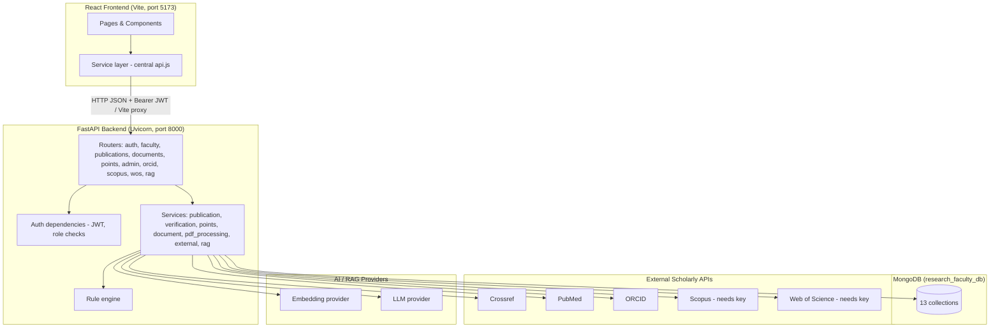
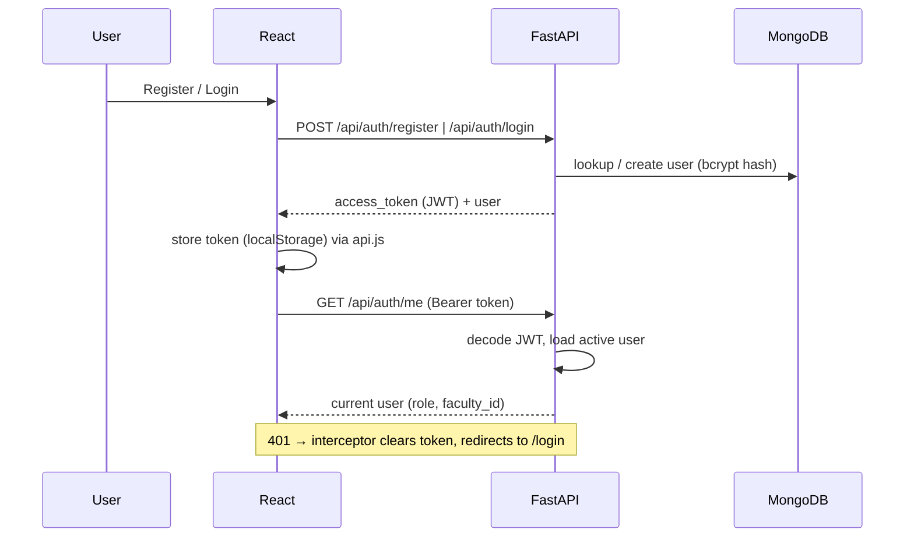
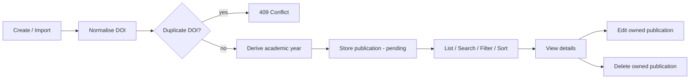
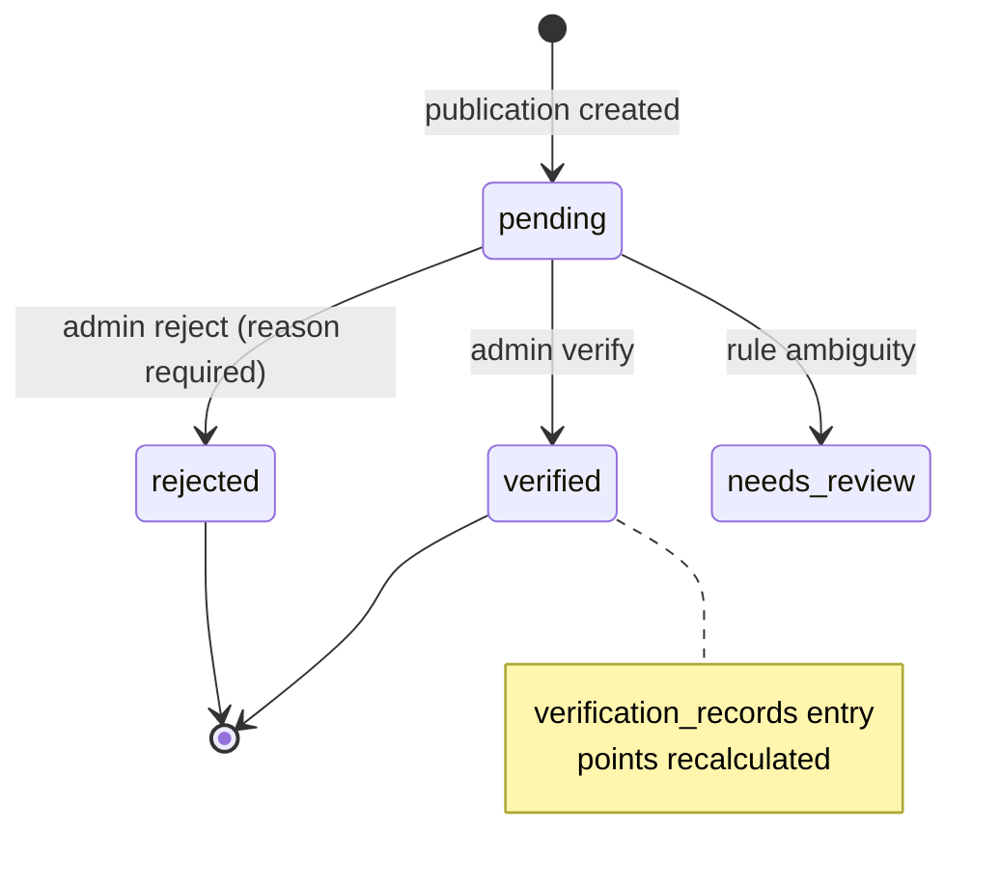
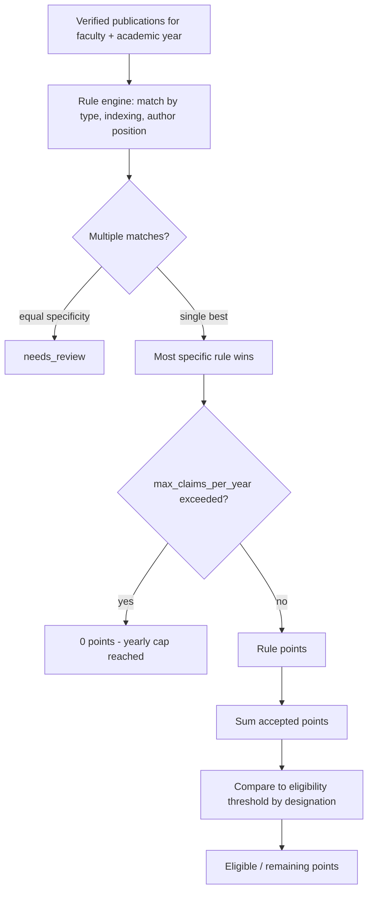
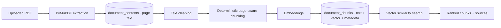
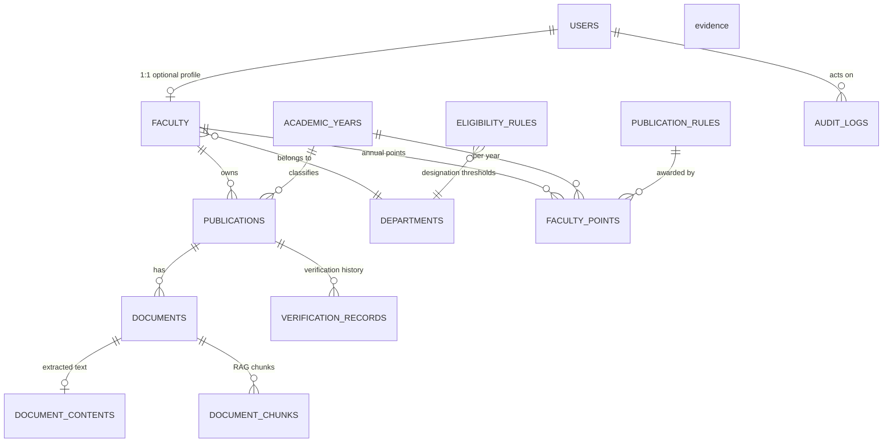

# Architecture

## Overview

The system is a three-tier application — a React single-page app, a FastAPI
backend, and MongoDB — augmented by external scholarly APIs and an
AI/RAG pipeline. The backend is the single source of truth: all authorization,
points, verification state and citations are computed server-side.

## A. System Architecture



## B. Authentication Flow



## C. Publication Workflow



## D. Verification Workflow



## E. Points Calculation Workflow



## F. PDF / RAG Pipeline



## G. AI Question-Answer Flow

```mermaid
sequenceDiagram
    participant U as Faculty
    participant F as AI Research Assistant
    participant A as FastAPI /api/rag/query
    participant DB as MongoDB
    participant L as LLM provider

    U->>F: Question (+ optional scope)
    F->>A: POST /api/rag/query (Bearer JWT, no faculty_id)
    A->>A: authorise scope from session
    A->>DB: embed query + similarity search (scoped)
    DB-->>A: ranked chunks
    A->>A: relevance filter + context assembly
    alt no relevant chunks
        A-->>F: safe no-answer message, no LLM call
    else relevant context
        A->>L: grounded prompt (system + untrusted context + question)
        L-->>A: answer text
        A->>A: validate answer; attach authoritative sources
        A-->>F: answer + real sources + model + time
    end
```

## H. Database / Entity Relationship (logical)



## Layer Connectivity

| Layer | Connects to | Evidence |
|---|---|---|
| React | FastAPI via central `api.js` (Bearer JWT) | 23 routes, 16 services, all use one axios client |
| FastAPI | MongoDB | health `{status:ok, database:connected}`; CRUD verified in `document_chunks` etc. |
| FastAPI | External APIs | live Crossref/PubMed/ORCID; Scopus/WoS return safe 503 without keys |
| FastAPI | Rule engine | `app/rules/rule_engine.py`, used by `points_service` |
| Documents | PDF processing | `pdf_processing_service` → `document_contents` |
| RAG | Embeddings + vector store + LLM | `app/services/rag/*` → `document_chunks` |

## Key Directories

```
backend/app/
  config/       settings (env-driven)
  database/     MongoDB client + index creation
  models/       collection names, indexes, enums
  schemas/      Pydantic request/response models
  routes/       API routers (+ admin/)
  services/     business logic (+ services/rag/)
  rules/        publication rule engine
  integrations/ external API clients
  utils/        security, author matching
frontend/src/
  pages/        route screens (+ admin/)
  components/   reusable UI
  services/     axios API layer (central api.js)
  hooks/        useAuth
  layouts/      AppLayout, AuthLayout
  utils/        formatting, error mapping
docs/           this documentation
```
