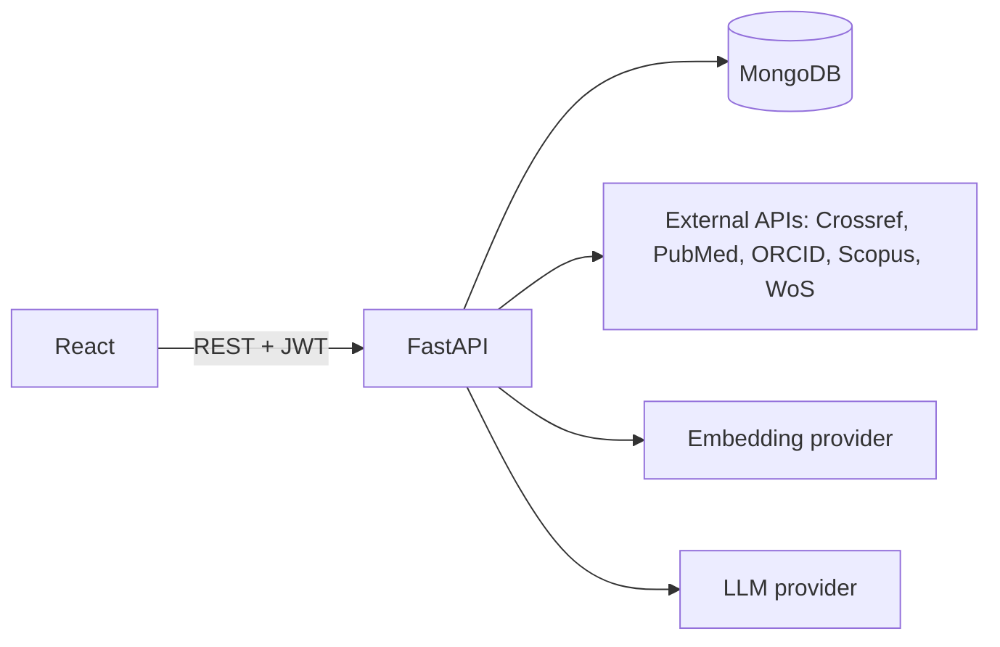
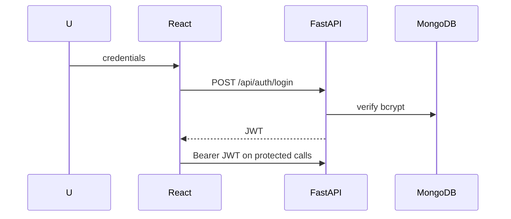
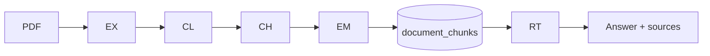

# Final Project Report

**AcadNova — A New Era of Research.**

An academic research and faculty performance platform with publication
verification, performance analytics, and an AI Research Assistant.

---

## 1. Introduction

Faculty research output must be recorded, verified and evaluated against an
institutional performance policy to determine annual points and increment
eligibility. This project is a full-stack web application that centralises
publication management, integrates external scholarly databases, applies a
configurable rule engine, manages publication evidence, and provides an AI
Research Assistant that answers questions grounded strictly in a faculty
member's own uploaded documents.

The system is implemented as a React single-page application, a FastAPI backend
and a MongoDB database, with an optional RAG/LLM pipeline.

## 2. Problem Statement

Manual research-performance tracking is fragmented and error-prone: publications
are spread across sources, evidence is stored ad hoc, verification is
inconsistent, point calculations are opaque and hard to audit, and faculty have
no secure way to query their own documents. There is no single, rule-driven,
auditable system to compute points and eligibility.

## 3. Existing System

Typically: spreadsheets and manual data entry; points computed manually from a
PDF policy; no duplicate detection; no verified evidence trail; reports compiled
by hand; no access control beyond shared files. Result: inconsistency,
duplication, poor auditability and no self-service for faculty.

## 4. Proposed System

A role-based web application where:
- faculty record/import publications, upload PDF evidence, and view points;
- admins verify submissions and manage institutional configuration;
- a **configurable rule engine** (data-driven, no hardcoded points) computes
  points and eligibility;
- documents are stored securely with checksums and soft deletion;
- an **AI assistant** answers from the faculty member's processed documents with
  authoritative citations.

## 5. Objectives

Encode the policy as configurable rules; ensure authoritative authorization and
ownership; guarantee duplicate protection and DOI normalisation; provide an
auditable verification workflow; compute points/eligibility server-side; manage
evidence securely; provide grounded, citation-backed AI answers; deliver
comprehensive documentation and tests.

## 6. Scope

In scope: authentication/roles, faculty profiles, publications and external
import, verification, rule engine, points/eligibility, documents/PDF extraction,
reports, admin management, and the AI/RAG assistant. Out of scope: payroll,
HR/finance integration, real-time collaboration, and mobile-native apps.

## 7. Functional Requirements

FR1 register/login/roles; FR2 profile management; FR3 publication CRUD with
search/filter/sort/pagination; FR4 external search/import; FR5 verification with
reason and history; FR6 configurable rules; FR7 points & eligibility per
academic year; FR8 document upload/download/delete with extraction; FR9 reports;
FR10 admin management; FR11 AI Q&A grounded in documents; FR12 audit logging.

## 8. Non-Functional Requirements

Security (JWT, bcrypt, ownership, no secret leakage); correctness (points and
state derived server-side); performance (indexed queries, bounded retrieval);
usability (responsive, accessible UI, clear states); maintainability (layered
services, central config); testability (isolated test DB, mocked externals).

## 9. System Architecture

Three-tier architecture with a service layer, a rule engine, and an AI/RAG
subsystem. See `docs/ARCHITECTURE.md` for full diagrams.

## 10. Module Description

- **Auth**: register/login/JWT/`me`, role guards.
- **Faculty**: profile read/update; department lookup.
- **Publications**: CRUD, DOI normalisation, duplicate protection, academic-year
  derivation, external import.
- **External integration**: Crossref/PubMed/ORCID (live), Scopus/WoS (keys).
- **Verification**: admin verify/reject, required reason, history, audit.
- **Rule engine & Points**: rule matching, specificity, ambiguity → review,
  yearly caps, points aggregation, eligibility.
- **Documents/PDF**: upload validation, SHA-256, extraction, soft delete.
- **Reports**: publications, annual points, verification, faculty summary.
- **Admin**: academic years, departments, faculty, rules, eligibility, summary.
- **AI/RAG**: cleaning, chunking, embeddings, vector store, retrieval, grounded
  answering, citations.

## 11. Database Design

Thirteen MongoDB collections (`users`, `faculty`, `departments`,
`academic_years`, `publications`, `publication_rules`, `eligibility_rules`,
`faculty_points`, `verification_records`, `documents`, `document_contents`,
`document_chunks`, `audit_logs`) with centrally declared indexes. Full schemas:
`docs/DATABASE_DESIGN.md`.

## 12. API Design

60 REST paths grouped by tag (auth, faculty, publications, documents,
verification, points, admin, orcid, scopus, web-of-science, rag), documented via
FastAPI OpenAPI at `/docs`. See `docs/API_DOCUMENTATION.md`.

## 13. Authentication and Authorization

JWT bearer tokens (HS256) with a required environment secret; bcrypt password
hashing; faculty/admin roles; per-resource ownership checks; the frontend never
supplies `faculty_id`.

## 14. Publication Management

CRUD with validation: DOI normalisation and uniqueness, server-derived academic
year (1 Jul → 30 Jun), verification status `pending`, `points_awarded = 0`.
Search/filter/sort/pagination are backend-driven.

## 15. External Scholarly API Integration

Crossref, PubMed and ORCID are live (public APIs). Scopus and Web of Science
have complete clients but require provider API keys; without them they return a
safe `503`. External failures are handled gracefully; results are normalised
into a common shape before import.

## 16. Author Matching

Author identifiers (ORCID and source-author IDs) are normalised and matched to
determine author position and corresponding authorship, which feed the rule
engine's author-position criteria.

## 17. Publication Verification

Admins verify or reject pending publications; rejection requires a reason.
Every action creates a `verification_records` entry and updates the
publication's status. Faculty cannot verify their own publications; unauthorized
users receive `403`.

## 18. Institutional Rule Engine

Rules are stored as data (`publication_rules`) matching on publication type,
indexing, author position, corresponding-author requirement and more. Selection
is deterministic: **the most specific rule wins**; equal specificity at the top
yields `needs_review`; `max_claims_per_year` caps repeated claims.

## 19. Points and Eligibility

Verified publications are scored by the engine, aggregated per academic year
(`faculty_points`) with category totals, and compared to the designation
threshold (`eligibility_rules`): Assistant Professor 100, Associate Professor
200, Professor 200. Unverified publications yield zero; no points are hardcoded
in application logic.

## 20. Document Management

PDF-only uploads validated by extension, MIME and `%PDF-` magic bytes, hashed by
SHA-256 (duplicate → `409`), size-limited, stored on the filesystem with
sanitised UUID names; APIs never expose storage paths. Soft deletion is used;
path-traversal and IDOR are prevented.

## 21. PDF Processing

PyMuPDF extracts page-aware text into `document_contents` with a quality signal;
scanned PDFs without extractable text are flagged (OCR not enabled). Processing
status is tracked (`not_processed`/`processing`/`processed`/`failed`).

## 22. AI/RAG Pipeline

PDF → extraction → cleaning → deterministic page-aware chunking → embeddings →
`document_chunks` → similarity search → ranked chunks. See
`docs/AI_RAG_ARCHITECTURE.md`.

## 23. AI Research Assistant

The `/research-assistant` page sends questions to `POST /api/rag/query`. The
backend embeds the query, retrieves the faculty member's scoped chunks, applies
a relevance cutoff, assembles bounded context, calls the LLM with a grounding
prompt, and returns the answer plus authoritative sources (document, page,
relevance). No-answer, not-configured and provider-failure states are safe.

## 24. Security

JWT + bcrypt, role/ownership enforcement, IDOR and path-traversal prevention,
client-controlled-field protection, secret management via environment, no
stack-trace/secret leakage, prompt-injection defense, and backend-owned
citations. See `docs/SECURITY.md`.

## 25. Testing

Three layers: pytest (backend, isolated DB), Node utility harnesses, and Python
contract flows against the live stack; plus RAG quality/security suites. See
`docs/TESTING.md`.

## 26. Results

| Suite | Result |
|---|---|
| Backend pytest | 408 passed |
| Frontend harnesses (7) | 461 passed |
| Contract flows (8) | 399 passed |
| Live DB integration verifier | 44/44 |
| Live RAG/security verifier | 21/21 |
| Production build | success, 0 warnings |

Live validation confirmed MongoDB persistence for every module, cross-faculty
isolation, safe no-answer/AI-not-configured behaviour, and clean teardown of all
temporary data.

## 27. Limitations

- No live LLM/embedding provider is configured in this environment, so live
  model answers are not demonstrated; the provider-not-configured path is
  verified and no fake answers are produced.
- Scopus and Web of Science require provider credentials.
- MongoDB has no Atlas `$vectorSearch` index locally, so RAG uses brute-force
  cosine similarity (correct, not ANN-indexed).
- No persistent chat history / multi-turn memory.
- No application-level rate limiting (resource usage is bounded instead).

## 28. Future Scope

- Configure a production LLM/embedding provider and Atlas Vector Search.
- Add conversation memory and multi-document reasoning.
- Add granular rate limiting and observability/metrics.
- Expand rule engine and reporting (e.g., scheduled reports, exports).
- Add CI to run the full test suite automatically.

## 29. Conclusion

The system meets its objectives: a secure, tested, rule-driven platform for
managing faculty research publications, evidence and performance, augmented by a
grounded AI assistant with authoritative citations. All core layers are
connected and validated end-to-end, with documentation suitable for MCA project
submission and demonstration.
